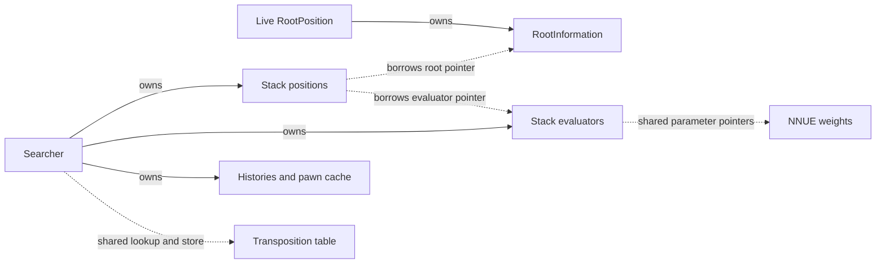
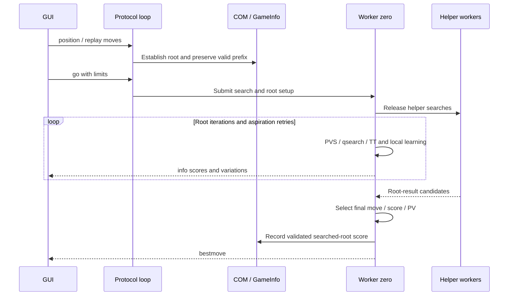

# Architecture and lifecycle

[Index](https://github.com/tryingsomestuff/Minic/blob/master/Doc/technical/README.md) | [Next: positions and moves](https://github.com/tryingsomestuff/Minic/blob/master/Doc/technical/positions-and-moves.md)

## Main source map

| Source | Responsibility |
|---|---|
| [minic.cpp](https://github.com/tryingsomestuff/Minic/blob/master/Source/minic.cpp), [minic.hpp](https://github.com/tryingsomestuff/Minic/blob/master/Source/minic.hpp) | Entry point, initialization, mode dispatch and shutdown. |
| [definition.hpp](https://github.com/tryingsomestuff/Minic/blob/master/Source/definition.hpp), [config.hpp](https://github.com/tryingsomestuff/Minic/blob/master/Source/config.hpp) | Fundamental types, encodings, feature gates and limits. |
| [option.cpp](https://github.com/tryingsomestuff/Minic/blob/master/Source/option.cpp), [dynamicConfig.cpp](https://github.com/tryingsomestuff/Minic/blob/master/Source/dynamicConfig.cpp) | Option registry, callbacks and runtime configuration. |
| [com.cpp](https://github.com/tryingsomestuff/Minic/blob/master/Source/com.cpp), [com.hpp](https://github.com/tryingsomestuff/Minic/blob/master/Source/com.hpp) | Protocol-shared position, game history and search lifecycle operations. |
| [uci.cpp](https://github.com/tryingsomestuff/Minic/blob/master/Source/uci.cpp), [xboard.cpp](https://github.com/tryingsomestuff/Minic/blob/master/Source/xboard.cpp) | Protocol parsing and protocol-specific game handling. |
| [threading.cpp](https://github.com/tryingsomestuff/Minic/blob/master/Source/threading.cpp), [threading.hpp](https://github.com/tryingsomestuff/Minic/blob/master/Source/threading.hpp) | Worker pool and copied search input/output. |
| [searcher.hpp](https://github.com/tryingsomestuff/Minic/blob/master/Source/searcher.hpp), [searcher.cpp](https://github.com/tryingsomestuff/Minic/blob/master/Source/searcher.cpp) | Worker state, stack, histories, timing checks and lifecycle. |
| [searcherDriver.cpp](https://github.com/tryingsomestuff/Minic/blob/master/Source/searcherDriver.cpp) | Iterative deepening and final result selection. |

## Startup

`minic()` initializes the engine before dispatching a developer command or a
protocol loop. The significant order in `init()` is:

1. Distributed runtime, options and logging.
2. Zobrist keys and TT allocation.
3. Board/attack masks, optional magic attacks, KPK and material knowledge.
4. Evaluation configuration and the thread pool.
5. Late distributed initialization, Syzygy and NNUE loading.
6. `COM::init()`, root-position setup and optional energy monitoring.

Options and network availability affect later initialization. Merely compiling
`WITH_NNUE` does not establish `DynamicConfig::useNNUE`; successful loading does.
Similarly, compiled Syzygy support does not imply that table files are available.

At shutdown, the engine stops workers, waits for them, clears the pool's workers,
finishes distributed operations and finalizes monitoring/logging. Do not destroy
shared root information or weights while workers still reference them.

## Three configuration layers

**Build-time gates** in `config.hpp` remove or include code. Examples are NNUE,
Syzygy, MPI, timers and tuning support.

**Algorithm switches and parameters** in `searchConfig.*` control search
heuristics. Many parameters are constants normally and become mutable in a
search-tuning build through `CONST_SEARCH_TUNING`. Local `constexpr bool`
switches in `depthPolicy()` are a further layer: a descriptive branch can exist
but be compiled away.

**Runtime options** live in `DynamicConfig`, registered through `Options`.
They include hash sizes, threads, MultiPV, NNUE file/scaling, contempt, skill and
variant settings. Some callbacks are delayed until `isready`; some operations
cannot safely run during a search. Read the registration and callback together,
not just the global's initial value.

## Ownership boundaries

| Object | Owns or represents |
|---|---|
| `COM::position` | Protocol-visible `RootPosition`. |
| `COM::GameInfo` | Initial game position, subsequent played positions/moves and optional searched-root scores. |
| `RootPosition` | Root castling metadata referenced by ordinary `Position` copies. |
| `ThreadData` | Copied search input plus the worker's current output/PV/statistics by depth. |
| `Searcher` | Worker thread, stack, local histories, pawn cache and correction tables. |
| TT | One shared transposition cache for local workers. |
| NNUE weights | Shared static network parameters. |
| Stack NNUE evaluators | Per-slot accumulators associated with the slot's position. |

Copying a `Position` does not copy ownership of its root metadata or its
associated evaluator. This deliberate lightweight representation requires
explicit lifetime and evaluator-association discipline.

## UCI: position -> search -> bestmove

For a normal sequence such as:

```text
ucinewgame
position startpos moves e2e4 e7e5
go wtime 60000 btime 60000 winc 500 binc 500
```

`ucinewgame` calls `COM::init()`, which resets the protocol root, worker game
state and `GameInfo`. The optional previous-game PGN write precedes the reset.

`position` reads the initial FEN and applies the supplied moves to
`COM::position`. In the documented working tree, it builds a temporary
`GameInfo`; `replace()` preserves optional scores along the old history's
unchanged prefix. A different initial position or divergent move invalidates
scores beyond the common prefix.

`go` populates `TimeMan` limits and calls `COM::thinkAsync()`. That constructs
`ThreadData`, allocates the initial time budget and passes the data to
`ThreadPool::startSearch()`. Workers receive position copies, not ownership of
the GUI position.

The main searcher runs iterative deepening, eventually selects a result and
publishes the searched root's score. `COM::receiveMoves()` then reports the
move. An implementation detail is that it also applies the move to
`COM::position`, even for UCI; the next `position` command reconstructs the
authoritative game state. Do not interpret this as fully stateless UCI internals.

## XBoard differences

XBoard keeps a more explicitly stateful game: force/analyze/play modes,
side-to-move bookkeeping, opponent moves and engine moves. `receiveOppMove()`
and `moveApplied()` append played positions to `GameInfo`.

Undo/remove uses `replay()`: reconstruct the remaining move sequence and retain
scores only in the retained prefix. Setting a board or starting a new game
resets history rather than inventing moves preceding the supplied position.

Move legality and variant behavior are shared with the engine core; the
protocols do not each maintain independent board implementations.

## The main searcher is not the protocol thread

Even `Threads = 1` has a protocol/control thread and a search worker. Each
`Searcher` owns a `std::thread`, mutex and condition variable; searcher index
zero is what `isMainThread()` means.

The protocol loop continues accepting commands while the worker searches.
The main worker starts helpers; an atomic start lock delays them until the
driver releases them. Workers normally explore their own trees and communicate
indirectly through the TT, not through a centrally split move queue.

Read [time and parallelism](https://github.com/tryingsomestuff/Minic/blob/master/Doc/technical/time-and-parallelism.md) before changing publication
or shared-state synchronization.

## Developer and auxiliary paths

`DEBUG_TOOL` enables CLI operations such as perft, SEE, evaluation, qsearch and
analysis. The desktop configuration forces this gate on. `WITH_TEST_SUITE`
adds tactical/position-suite machinery; data generation/conversion and tuning
have additional gates.

Not every `searchDriver()` invocation represents the live GUI game.
`subSearch` marks auxiliary work; `postMove` controls move reporting. The current
score-history integration uses both to avoid recording unrelated analyses.
`postMove` is a practical gate, not a semantic proof that a root belongs to
`GameInfo`; the setter separately validates membership.

## Ownership and lifetime graph



Solid arrows denote ownership; dashed arrows denote access/association.
The TT does not own the searched `Position` objects.

Copying a plain `Position` does not extend the lifetime of `RootInformation`.
`RootPosition` copy construction deep-copies that information; assignment is
deleted. Plain child copies inherit evaluator pointers until a stack helper
reassociates them.

This deliberately avoids reference-count operations on every node, but places
the lifetime contract in search setup and protocol synchronization. A temporary
root must not disappear while its copied search positions remain in use.

## UCI search lifecycle diagram



This summarizes control and data flow, not a synchronization proof. Helpers
cooperate mainly through shared TT accesses, omitted here for readability.
The distinction between provisional `info` and final root publication is
intentional; an auxiliary search may not publish a game score.

## Publication is not the same as computation

Working scores and PVs change during aspiration retries and incomplete
iterations. Reporting a `bestmove` chooses a final root result, potentially
with worker voting. `GameInfo::setSearchScore()` records that chosen result
only after its root validation; it is not updated for each PVS node or each
transposition encounter.

Three consumers therefore need different data:

| Consumer | Required state |
|---|---|
| Recursive search | Current position, local stack context, current window. |
| Iteration time policy | Completed-depth root scores and instability estimates. |
| Across-move time policy | Optional final scores for earlier searched game roots. |

Using one consumer's storage for another conflates search attempts, completed
analysis and actual game history. The absolute-ply stack is useful for local
tree continuity, but it is not a durable score ledger for the GUI's game.

## Architectural tradeoffs

The engine favors compact types, templates and explicit state over a generic
framework. Board state is copy/make, evaluation combines specialized knowledge
with NNUE, and most search heuristics operate in one large PVS implementation.
This reduces some indirection but makes ordering and shared invariants important.

A local change can have non-local consequences: move scores affect LMR, castling
encoding affects histories, evaluation selection affects available attack data,
and game-history publication affects timing. These are the boundaries the
remaining chapters make explicit.
