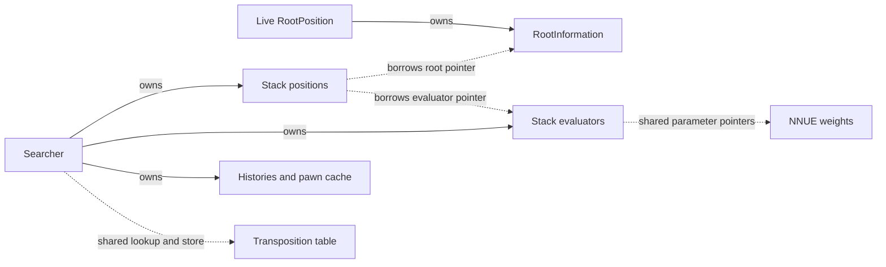
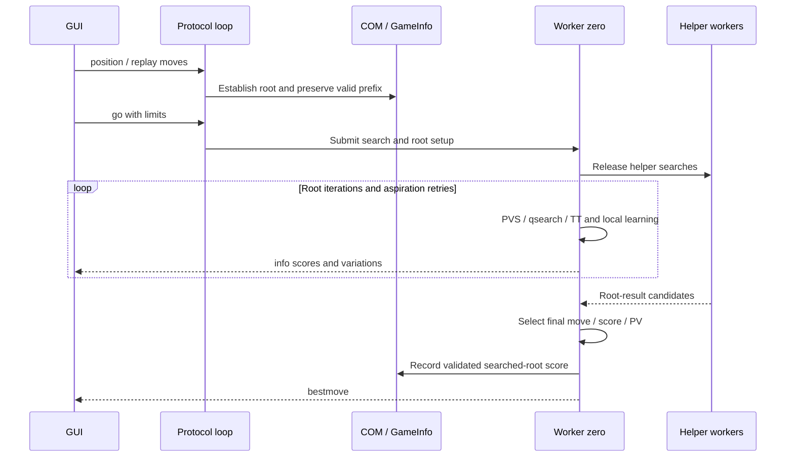

# Architecture and lifecycle

[Index](https://github.com/tryingsomestuff/Minic/blob/master/Doc/technical/README.md) | [Next: positions and moves](https://github.com/tryingsomestuff/Minic/blob/master/Doc/technical/positions-and-moves.md)

## Repository layout

| Directory | Content |
|---|---|
| [Source/](https://github.com/tryingsomestuff/Minic/blob/master/Source) | The engine: board, move generation, search, evaluation, protocols and developer tools. |
| [Source/nnue/](https://github.com/tryingsomestuff/Minic/blob/master/Source/nnue) | NNUE inference code, weight loading and the learner/data-conversion code. |
| [Fathom/](https://github.com/tryingsomestuff/Minic/blob/master/Fathom) | Syzygy tablebase probing library (git submodule), linked when present. |
| [Train/](https://github.com/tryingsomestuff/Minic/blob/master/Train) | Python/PyTorch NNUE training pipeline; not part of the engine build. |
| [Tools/](https://github.com/tryingsomestuff/Minic/blob/master/Tools) | Build scripts, tuning and analysis scripts, tournament helpers. |
| [Test/](https://github.com/tryingsomestuff/Minic/blob/master/Test) | The pytest smoke tests that launch the built executable. |
| [Book_and_Test/](https://github.com/tryingsomestuff/Minic/blob/master/Book_and_Test) | Opening books, test suites and tuning data. |
| [Doc/](https://github.com/tryingsomestuff/Minic/blob/master/Doc) | This documentation. |

## Main source map

| Source | Responsibility |
|---|---|
| [minic.cpp](https://github.com/tryingsomestuff/Minic/blob/master/Source/minic.cpp), [minic.hpp](https://github.com/tryingsomestuff/Minic/blob/master/Source/minic.hpp) | Entry point, initialization, mode dispatch and shutdown. |
| [definition.hpp](https://github.com/tryingsomestuff/Minic/blob/master/Source/definition.hpp), [config.hpp](https://github.com/tryingsomestuff/Minic/blob/master/Source/config.hpp) | Fundamental types, encodings, feature gates and limits. |
| [option.cpp](https://github.com/tryingsomestuff/Minic/blob/master/Source/option.cpp), [dynamicConfig.cpp](https://github.com/tryingsomestuff/Minic/blob/master/Source/dynamicConfig.cpp) | Option registry, callbacks and runtime configuration. |
| [com.cpp](https://github.com/tryingsomestuff/Minic/blob/master/Source/com.cpp), [com.hpp](https://github.com/tryingsomestuff/Minic/blob/master/Source/com.hpp) | Protocol-shared position, game history and search lifecycle operations. |
| [uci.cpp](https://github.com/tryingsomestuff/Minic/blob/master/Source/uci.cpp), [xboard.cpp](https://github.com/tryingsomestuff/Minic/blob/master/Source/xboard.cpp) | Protocol parsing and protocol-specific game handling. |
| [threading.cpp](https://github.com/tryingsomestuff/Minic/blob/master/Source/threading.cpp), [threading.hpp](https://github.com/tryingsomestuff/Minic/blob/master/Source/threading.hpp) | Worker pool and copied search input/output. |
| [searcher.hpp](https://github.com/tryingsomestuff/Minic/blob/master/Source/searcher.hpp), [searcher.cpp](https://github.com/tryingsomestuff/Minic/blob/master/Source/searcher.cpp) | Worker state, stack, histories, timing checks and lifecycle. |
| [searcherDriver.cpp](https://github.com/tryingsomestuff/Minic/blob/master/Source/searcherDriver.cpp) | Iterative deepening and final result selection. |

## Startup

`main()` in [minic.cpp](https://github.com/tryingsomestuff/Minic/blob/master/Source/minic.cpp)
only calls `minic()`, defined in
[minic.hpp](https://github.com/tryingsomestuff/Minic/blob/master/Source/minic.hpp).
`minic()` **always** runs `init()` first, even for `-h`, so every invocation
allocates the TT, the material table and the worker pool before looking at
its command line. `init()` reads:

```cpp
inline void init(int argc, char** argv) {
   Distributed::init();
   Logging::hellooo();
   Options::initOptions(argc, argv);
   Logging::init(); // after reading options
   Zobrist::initHash();
   TT::initTable();
   BBTools::initMask();
#ifdef WITH_MAGIC
   BBTools::MagicBB::initMagic();
#endif
   KPK::init();
   MaterialHash::MaterialHashInitializer::init();
   EvalConfig::initEval();
   ThreadPool::instance().setup();
   Distributed::lateInit();
#ifdef WITH_SYZYGY
   SyzygyTb::initTB();
#endif
#ifdef WITH_NNUE
   NNUEWrapper::init();
#endif
   COM::init(COM::p_uci); // let's do this ... (usefull to reset position in case of NNUE)
   sizeOf();
   // Start energy monitoring
   initEnergyMonitor(500);
}
```

The order matters:

- Command-line options (`-<identifier> <value>` pairs named after the
  `DynamicConfig` globals, such as `-ttSizeMb 256`, see
  [development](https://github.com/tryingsomestuff/Minic/blob/master/Doc/technical/development.md#runtime-options-and-their-registration))
  are read before logging is configured and before any table is sized, so the
  TT size, pawn-cache size and thread count are known when the TT and the
  worker pool are created.
- Zobrist keys come before anything that hashes a position; attack masks
  (and magic tables) come before KPK, whose bitbase generation uses them.
- `NNUEWrapper::init()` sets `DynamicConfig::useNNUE` to true only if a network
  was actually loaded. Merely compiling `WITH_NNUE` does not enable NNUE.
  Similarly `SyzygyTb::initTB()` does nothing without a `syzygyPath`.
- `COM::init()` comes last because it reads the start position into the
  protocol root (which needs masks, hashes and, with NNUE, a loaded network)
  and resets every worker's game state.
- `sizeOf()` logs `sizeof(Position)` and `sizeof(Searcher::PVSData)`; it is
  the quickest way to see the real size of the copy/make unit on a given build.

After `init()`, `minic()` dispatches in this order: help (`-h`, `--help`...),
the test-suite names when `WITH_TEST_SUITE` is compiled, `-tuning` with
`WITH_EVAL_TUNING`, `-pgn` with `WITH_PGN_PARSER`, the data conversion commands
(`-plain2bin`, `-pgn2bin`, `-bin2plain`, `-rescore`) with `WITH_DATA2BIN`, and
finally `cliManagement()` when `DEBUG_TOOL` is defined. An empty command line
becomes `-uci`. Without `DEBUG_TOOL` (not the default) the engine ignores its
arguments for mode selection and enters UCI if `WITH_UCI` is compiled,
XBoard otherwise. An Emscripten build skips all of this and exports
`processCommand()`, which forwards one line to the UCI parser.

`finalize()` stops workers, waits for them, destroys the pool's workers,
synchronizes distributed processes, reports energy use and closes logging.
Do not destroy shared root information or weights while workers still
reference them.

## Identifying a build

The version reported by `uci` (`id name Minic ...`) and by the XBoard `myname`
feature is built from `MinicBaseVersion` in
[config.hpp](https://github.com/tryingsomestuff/Minic/blob/master/Source/config.hpp), the six-character Git commit of the
checkout and an optional `-dirty` suffix, for example `3.47-af45d8-dirty`.
The build script generates the commit information; a build made outside a Git
checkout reports `unknown`. `-dirty` marks tracked changes and new files under
`Source`. With more than one MPI process, `MinicVersionWithProcessCount()`
appends `_<n>proc`. Always record this string when comparing two binaries: it
tells whether the executable matches a given commit.

## Three configuration layers

**Build-time gates** in `config.hpp` remove or include code with `#define`.
They cannot be changed by any option: a compiled-out feature does not exist in
the executable. The desktop configuration (anything not `WITH_SMALL_MEMORY`,
which `ARDUINO`/`ESP32` select) enables `WITH_UCI`, `WITH_XBOARD`,
`WITH_MAGIC`, `WITH_NNUE`, `WITH_STATS`, `WITH_MATERIAL_TABLE`,
`WITH_ASYNC_ANALYZE`, `WITH_SYZYGY` (except with MSVC), `USE_SIMD_INTRIN`
(except on Android), `USE_PARTIAL_SORT`, `DEBUG_TOOL` (forced), `WITH_TEST_SUITE`,
`WITH_GENFILE`, `WITH_DATA2BIN` and the pawn and non-pawn correction histories.

**Algorithm switches and parameters** in `searchConfig.*` control search
heuristics. They are `const` in a normal build and become mutable, and
registered as options, in a search-tuning build through `CONST_SEARCH_TUNING`.
Local `constexpr bool` switches in `depthPolicy()` are a further layer: a
descriptive branch can exist but be compiled away.

**Runtime options** live in `DynamicConfig`, registered through `Options`.
They include hash sizes, threads, MultiPV, NNUE file/scaling, contempt, skill,
style and variant settings. Read the registration and its callback together,
not just the global's initial value: `Hash` immediately reallocates and clears
the TT, `PawnHash` reallocates every pawn cache, and `Threads` destroys and
recreates every worker (with fresh pawn caches and cleared game state).
`Options::SetValue()` refuses every change while the main worker is searching.
The only UCI work deferred to `isready` is `Opponent::init()`, which applies
`UCI_Opponent`/`UCI_RatingAdv` information.

### Build gates that are off by default

The following gates are commented out in
[config.hpp](https://github.com/tryingsomestuff/Minic/blob/master/Source/config.hpp)
and are therefore **disabled by default**. Enabling one means uncommenting its
`#define` (or passing `-D<GATE>` in the build definitions) and rebuilding. The
complete inventory, including search and evaluation switches, is in
[disabled features](https://github.com/tryingsomestuff/Minic/blob/master/Doc/technical/disabled-features.md).

| Gate | What it would do | Caveat visible in the code |
|---|---|---|
| `WITH_MPI` | Multi-process ("distributed") search sharing TT entries and statistics. | `build.sh` detects the uncommented line and switches to `mpiicpx`/`mpiicx`. |
| `WITH_FMTLIB` | Colored "pretty" console output in CLI mode (`Pretty::init()`) and formatted search display. | Needs the `fmt` library; `build.sh` adds `-lfmt` only when the line is uncommented in `config.hpp`. |
| `WITH_PGN_PARSER` | `-pgn <file>` command that converts a PGN file into an EPD-like `<file>.edp` position file. | Developer data tool, unrelated to play. |
| `WITHOUT_FILESYSTEM` | For compilers lacking `std::filesystem`. | Also disables `WITH_GENFILE` and `WITH_DATA2BIN` and the network file-size check before loading. |
| `LIMIT_THREADS_TO_PHYSICAL_CORES` | Caps `Threads` in `ThreadPool::setup()`. | The cap is `std::thread::hardware_concurrency()`, which counts logical, not physical, cores. |
| `REPRODUCTIBLE_RESULTS` | Clears TT, pawn caches and all histories before every search, not only at new games. | Makes consecutive searches independent, at a strength cost; see [reset policy](https://github.com/tryingsomestuff/Minic/blob/master/Doc/technical/tables-and-history.md#reset-policy). |
| `WITH_TIMER` | `START_TIMER`/`STOP_AND_SUM_TIMER` accumulate `rdtsc` ticks per engine function and `Timers::Display()` prints them. | Without it the macros and `Display()` are empty. |
| `WITH_BETACUTSTATS` | Classifies each PVS beta cutoff by move category (TT, good capture, killers, counter...) and prints the breakdown after `bench`/`benchBig`. | Both the collection (`updateStatBetaCut()` in PVS) and the display are gated. |
| `WITH_SEARCH_TUNING`, `WITH_EVAL_TUNING`, `WITH_PIECE_TUNING` | Make search parameters, evaluation terms or piece values mutable and tunable. | See [tuning builds](https://github.com/tryingsomestuff/Minic/blob/master/Doc/technical/development.md#tuning-builds). |
| `WITH_NNUE_UNCERTAINTY`, `WITH_NNUE_PREFETCH`, `WITH_EVALSCORE_AS_INT`, `WITH_HORIZON_CORRHIST` | Network uncertainty head, NNUE row prefetch, packed `EvalScore`, depth-context correction history. | Described in the evaluation, NNUE and [tables](https://github.com/tryingsomestuff/Minic/blob/master/Doc/technical/tables-and-history.md#move-and-correction-tables) chapters. |
| `VERBOSE_EVAL`, `DEBUG_*` | Diagnostics and self-checks. | See [development](https://github.com/tryingsomestuff/Minic/blob/master/Doc/technical/development.md#debug-gates). |

## Ownership boundaries

| Object | Owns or represents |
|---|---|
| `COM::position` | Protocol-visible `RootPosition`. |
| `COM::GameInfo` | Initial game position, subsequent played positions/moves and optional searched-root scores. |
| `RootPosition` | Root castling metadata referenced by ordinary `Position` copies. |
| `ThreadData` | Copied search input plus the worker's current output/PV/statistics by depth. |
| `Searcher` | Worker thread, stack, local histories, pawn cache and correction tables. |
| TT | One shared transposition cache for local workers. |
| NNUE weights | Shared static network parameters. |
| Stack NNUE evaluators | Per-slot accumulators associated with the slot's position. |

Copying a `Position` does not copy ownership of its root metadata or its
associated evaluator. This deliberate lightweight representation requires
explicit lifetime and evaluator-association discipline.

## UCI: position -> search -> bestmove

For a normal sequence such as:

```text
ucinewgame
position startpos moves e2e4 e7e5
go wtime 60000 btime 60000 winc 500 binc 500
```

`ucinewgame` calls `COM::init()` (it is ignored with an `info string` while a
search is running). `COM::init()` optionally appends the previous game to a PGN
file (`PgnOut`), reads the start position into `COM::position`, clears
`GameInfo`, resets opponent information and calls `ThreadPool::clearGame()`,
which clears the TT and every worker's game state.

`position` first invalidates `COM::position` (its hash is set to `nullHash`),
reads the initial position, then applies each move with `COM::makeMove()`,
which rejects invalid or non-pseudo-legal moves before `applyMove()`. A `fen`
is read as exactly six whitespace-separated fields. Every applied move is
appended to a temporary `GameInfo`; `replace()` then installs it while
preserving optional scores along the old history's unchanged prefix. A
different initial position or a divergent move invalidates scores beyond the
common prefix.

`go` resets the limits and `DynamicConfig::mateFinder` (only `go mate <n>` sets
it back to true), populates `TimeMan` and calls `COM::thinkAsync()`. That
computes the move budget, constructs `ThreadData` from a copy of
`COM::position` and passes it to `ThreadPool::startSearch()`. Workers receive
position copies, not ownership of the GUI position.

The main searcher runs iterative deepening, eventually selects a result and
publishes the searched root's score. `COM::receiveMoves()` then reports the
move. An implementation detail is that it also applies the move to
`COM::position` (but does not append it to `GameInfo`), even for UCI; the next
`position` command reconstructs the authoritative game state. Do not interpret
this as fully stateless UCI internals.

## XBoard differences

XBoard keeps a more explicitly stateful game: force/analyze/play modes,
side-to-move bookkeeping, opponent moves and engine moves. `receiveOppMove()`
(for `usermove`) and `moveApplied()` (after the engine's own move) append the
played positions to `GameInfo`.

Undo/remove uses `replay()`: reconstruct the remaining move sequence from the
initial position and retain scores only in the retained prefix. `setboard`
and `new` reset history rather than inventing moves preceding the supplied
position. `new` also switches Chess960 off; `variant fischerandom` switches
it on.

Move legality and variant behavior are shared with the engine core; the
protocols do not each maintain independent board implementations.

## The main searcher is not the protocol thread

Even `Threads = 1` has a protocol/control thread and a search worker. Each
`Searcher` owns a `std::thread`, mutex and condition variable; searcher index
zero is what `isMainThread()` means.

The protocol loop continues accepting commands while the worker searches.
The main worker starts helpers; an atomic start lock delays them until the
driver releases them. Workers normally explore their own trees and communicate
indirectly through the TT, not through a centrally split move queue.

Read [time and parallelism](https://github.com/tryingsomestuff/Minic/blob/master/Doc/technical/time-and-parallelism.md) before changing publication
or shared-state synchronization.

## Developer and auxiliary paths

`DEBUG_TOOL` enables CLI operations such as perft, SEE, evaluation, qsearch and
analysis (listed in
[development](https://github.com/tryingsomestuff/Minic/blob/master/Doc/technical/development.md#focused-engine-diagnostics)).
The desktop configuration forces this gate on. `WITH_TEST_SUITE` adds
tactical/position-suite machinery; data generation/conversion and tuning have
additional gates.

Not every `searchDriver()` invocation represents the live GUI game.
`subSearch` marks auxiliary work; `postMove` controls move reporting. The current
score-history integration uses both to avoid recording unrelated analyses.
`postMove` is a practical gate, not a semantic proof that a root belongs to
`GameInfo`; the setter separately validates membership.

## Ownership and lifetime graph



Solid arrows denote ownership; dashed arrows denote access/association.
The TT does not own the searched `Position` objects.

Copying a plain `Position` does not extend the lifetime of `RootInformation`.
`RootPosition` copy construction deep-copies that information; assignment is
deleted. Plain child copies inherit evaluator pointers until a stack helper
reassociates them.

This deliberately avoids reference-count operations on every node, but places
the lifetime contract in search setup and protocol synchronization. A temporary
root must not disappear while its copied search positions remain in use.

## UCI search lifecycle diagram



This summarizes control and data flow, not a synchronization proof. Helpers
cooperate mainly through shared TT accesses, omitted here for readability.
The distinction between provisional `info` and final root publication is
intentional; an auxiliary search may not publish a game score.

## Publication is not the same as computation

Working scores and PVs change during aspiration retries and incomplete
iterations. Reporting a `bestmove` chooses a final root result, potentially
with worker voting. `GameInfo::setSearchScore()` records that chosen result
only after its root validation; it is not updated for each PVS node or each
transposition encounter.

Three consumers therefore need different data:

| Consumer | Required state |
|---|---|
| Recursive search | Current position, local stack context, current window. |
| Iteration time policy | Completed-depth root scores and instability estimates. |
| Across-move time policy | Optional final scores for earlier searched game roots. |

Using one consumer's storage for another conflates search attempts, completed
analysis and actual game history. The absolute-ply stack is useful for local
tree continuity, but it is not a durable score ledger for the GUI's game.

## Architectural tradeoffs

The engine favors compact types, templates and explicit state over a generic
framework. Board state is copy/make, evaluation combines specialized knowledge
with NNUE, and most search heuristics operate in one large PVS implementation.
This reduces some indirection but makes ordering and shared invariants important.

A local change can have non-local consequences: move scores affect LMR, castling
encoding affects histories, evaluation selection affects available attack data,
and game-history publication affects timing. These are the boundaries the
remaining chapters make explicit.
