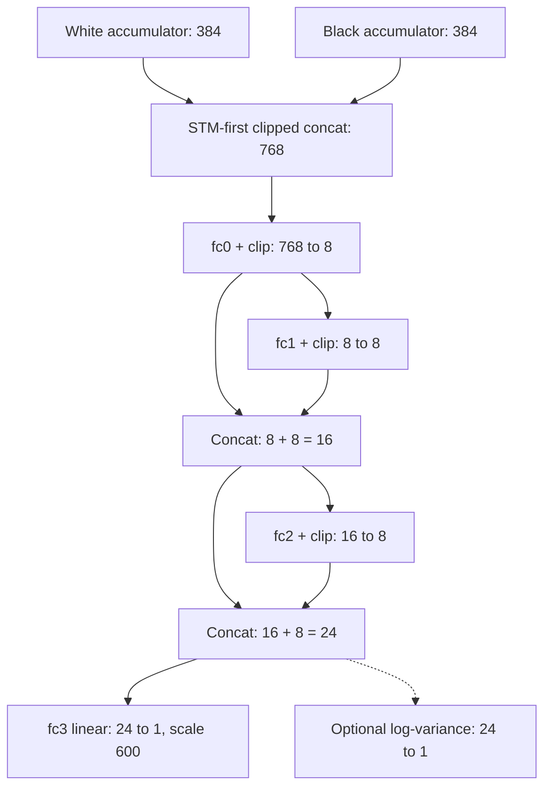

# NNUE topology and inference reference

[Index](https://github.com/tryingsomestuff/Minic/blob/master/Doc/technical/README.md)
| [Evaluation overview](https://github.com/tryingsomestuff/Minic/blob/master/Doc/technical/evaluation.md)

Implementation map:
[position.hpp](https://github.com/tryingsomestuff/Minic/blob/master/Source/position.hpp)
defines features and incremental changes;
[inputLayer.hpp](https://github.com/tryingsomestuff/Minic/blob/master/Source/nnue/inputLayer.hpp)
and [featureTransformer.hpp](https://github.com/tryingsomestuff/Minic/blob/master/Source/nnue/featureTransformer.hpp)
define accumulators;
[evaluator.hpp](https://github.com/tryingsomestuff/Minic/blob/master/Source/nnue/evaluator.hpp)
defines topology;
[weightReader.hpp](https://github.com/tryingsomestuff/Minic/blob/master/Source/nnue/weightReader.hpp)
defines loading;
[model.py](https://github.com/tryingsomestuff/Minic/blob/master/Train/model.py)
defines training/export.

## What an input feature means

For a given perspective, a feature is a conjunction of:

```text
that perspective's king square
piece square
piece kind
whether the piece belongs to the perspective or its opponent
```

There are `64 * (12 * 64) = 49152` indices. `FeatureIdx::major = 768` is the
stride per king square; `minor = 64` is the stride per colored piece kind.
Offsets are pawn/knight/bishop/rook/queen/king for us, then those six for them.
Both kings are included as occupied-square features.

The current index expression is:

```text
indexUs(k, s, p)   = 768 * HFlip(k) + HFlip(s) + usOffset(p)
indexThem(k, s, p) = 768 * HFlip(k) + HFlip(s) + themOffset(p)
HFlip(square)     = square XOR 7
getBlock(square)  = square
```

**The horizontal flip is unconditional.** It is not king-file-dependent
symmetry reduction, and there is no black-perspective vertical flip in this
expression. Color-relative ownership and separate transformer parameters
provide the perspective distinction. Do not substitute a conventional HalfKA
orientation from another engine.

An alternative 16-block expression is commented in `getBlock()`; it is not
the active 64-square layout. The sparse C++ training loader duplicates the
active expression; changing it requires synchronized feature/export changes.

### Concrete index

For white king e1 (4) and a white pawn e2 (12):

```text
HFlip(e1) = d1 = 3
HFlip(e2) = d2 = 11
white-us-pawn index = 768*3 + 11 + 0 = 2315
```

If black's king is e8 (60), its perspective treats that pawn as "them":

```text
black-them-pawn index = 768*59 + 11 + 384 = 45707
```

These access different matrices and rows. "Both perspectives see the same
piece" does not imply they use the same learned weights.

## Sparse affine transformers

For perspective `c` and accumulator component `j`:

$$
A_{c,j}=b_{c,j}+\sum_{i\in\mathcal{F}_c}W_{c,i,j},
\qquad j\in\{0,\ldots,383\}.
$$

Here $\mathcal{F}_c$ is the set of active features for perspective $c$;
$W_{c,i,j}$ and $b_{c,j}$ are stored input weights and biases.

Inactive input features are zero; there is no dense 49152-vector multiplication
at every position. Reset copies 384 biases and inserts one 384-row per occupied
square. There are two parameter sets, `weights.w` and `weights.b`, not one
shared transformer reused with only a color flip.

The model learns a king-conditioned linear summary; nonlinearity occurs when
the resulting accumulators are activated. Incremental updates are possible
because removing/adding a feature is subtracting/adding its row.

## Exact dense topology

Let `clip(x) = min(max(x, 0), 1)`. In the normal SIMD path:

```text
u = clip(A[sideToMove] / 512)
t = clip(A[opponent]   / 512)
x = concat(u, t)                              # 768

y0 = clip(W0*x + b0)                          # 8
z1 = clip(W1*y0 + b1)                         # 8
y1 = concat(y0, z1)                          # 16
z2 = clip(W2*y1 + b2)                         # 8
y2 = concat(y1, z2)                          # 24
evaluation = 600 * (W3*y2 + b3)               # 1
optional logVariance = Wvariance*y2 + bvariance
```

The final scalar is not clipped with ReLU. The skip connections are
**concatenations**, not residual sums. Earlier activated values remain directly
available to later layers and the output.

With $\phi(v)=\operatorname{clip}(v,0,1)$ applied componentwise, the dense
relationships are:

$$
\begin{aligned}
y_0 &= \phi(W_0x+b_0),\\
y_1 &= [\,y_0;\ \phi(W_1y_0+b_1)\,],\\
y_2 &= [\,y_1;\ \phi(W_2y_1+b_2)\,],\\
e &= 600\,(W_3y_2+b_3).
\end{aligned}
$$

The semicolon denotes concatenation. The diagram makes the different input
widths and bypass paths explicit:



The dense boxes refer to the selected phase bucket; transformers are not
duplicated per bucket. The dashed head is disabled in the normal build.

Although commonly abbreviated `768 -> 8 -> 8 -> 8 -> 1`, the actual middle
input widths are 8, 16 and 24. Ignoring the concatenations gives the wrong
weight count, binary format and inference equation.

## Bucket selection

Each dense layer has two bucket-specific parameter sets; input transformers
are shared across buckets.

```text
bucket = 0 if gamePhase < 0.45 else 1
```

This is phase based, not a literal piece-count bucket. Pawn and different
non-pawn material contribute different phase weights. Crossing the threshold
can select a different dense function without changing the feature layout.

The C++ sparse trainer computes phase from its own copied material constants;
ordinary engine evaluation can obtain quantized phase from the material table.
Near 0.45, verify both paths rather than assuming identically rounded selection.
Commented king-bucket and occupancy-count alternatives are inactive.

## Parameter and byte accounting

| Component | Parameters |
|---|---|
| One input transformer | `49152*384 + 384 = 18874752`. |
| Both input transformers | 37749504. |
| `fc0`, per bucket | `768*8 + 8 = 6152`. |
| `fc1`, per bucket | `8*8 + 8 = 72`. |
| `fc2`, per bucket | `16*8 + 8 = 136`. |
| Evaluation head, per bucket | `24 + 1 = 25`. |
| Both dense buckets, no optional head | `2*6385 = 12770`. |
| Total, no optional head | 37762274. |
| Optional variance heads | 50 additional parameters. |

The input matrices dominate capacity. Float serialization gives:

```text
4-byte version + 4 * 37762274 = 151049100 bytes
with optional heads: + 4 * 50 = 151049300 bytes
```

Quantized input matrices consume exactly 72 MiB of row storage, before input
biases, dense arrays and alignment. The two 384-value int16 accumulators contain
1536 bytes of values per position. Weights are shared across workers; those
accumulators are not.

## Quantization and numerical limits

Disk parameters are floats. Input rows/biases become
`round(floatValue * 512)` in signed 16-bit storage. The loader logs and clamps
out-of-range individual weights/biases.

With input scale $q=512$, the normal SIMD path can be summarized as:

$$
\begin{aligned}
\widehat W_{c,i,j} &= \operatorname{round}(q W_{c,i,j}),\\
\widehat b_{c,j} &= \operatorname{round}(q b_{c,j}),\\
\widehat A_{c,j} &= \widehat b_{c,j}
                   + \sum_{i\in\mathcal F_c}\widehat W_{c,i,j},\\
x_{c,j} &= \operatorname{clip}(\widehat A_{c,j}/q,0,1).
\end{aligned}
$$

The stored accumulator is the **unclipped** sum. Clipping its stored value
after each insertion would lose information and invalidate later erase/add
updates. Activation belongs to propagation.

If all parameters fit without load-time clamping and no accumulator overflows,
rounding gives the per-component preactivation error bound:

$$
\left|\widehat A_{c,j}/q-A_{c,j}\right|
\leq \frac{|\mathcal F_c|+1}{2q}.
$$

For 32 active features, this is $33/1024 \simeq 0.03223$ before dense inference.
It is not a centipawn-error guarantee: the dense weights, subsequent activations
and output scale determine how the error propagates.

That per-parameter check does not prove every sum of active rows fits int16.
`StackVector` incremental operations do not add an explicit accumulator
saturation policy. Training/export must preserve reasonable ranges, and reset
versus incremental comparisons should include crowded/material-unusual boards.

Dense weights and biases remain float; this is not a fully integer NNUE.
Accumulator dequantization, dense matrix multiplication and clipping therefore
have different numerical characteristics.

`NNUEALIGNMENT` is 64 bytes. `StackVector` and matrix/bias arrays use aligned
storage. SIMD input conversion widens int16 values, multiplies by 1/512 and
clamps to [0,1], with vector and tail loops. Dense dot products exploit
architecture-dependent SIMD; exact rounding need not be bit-identical across
compiler/ISA/FMA settings.

### Historical fully integer formulation

The former standalone quantization note described a different design:
integer dense weights/activations and wider integer biases/dot products.
Its reasoning is preserved here as a historical design reference, **not**
as a description of the currently enabled mixed int16/float network.

Start from a floating hidden layer
$y_i=\operatorname{clip}(W_i y_{i-1}+b_i,0,1)$. Assume a weight bound
$|W_i|<\alpha$, choose an integer activation range $[0,n]$, and define
$f=n/\alpha$. Let $Q$ convert a scaled real value to an integer.
The original derivation used floor; the current input loader uses rounding.
These quantizers have different error and negative-value behavior.

For binary sparse input $x$, quantize the first affine layer at scale $n$:

$$
\begin{aligned}
\overline W_0 &= Q(n W_0), &
\overline b_0 &= Q(n b_0),\\
a_0 &= \overline W_0x+\overline b_0, &
z_0 &= \operatorname{clip}(a_0,0,n)\simeq n y_0.
\end{aligned}
$$

Input weights can exceed int8 even when subsequent dense weights fit it;
the historical proposal therefore used int16 for input rows. Input
**accumulator** width must still be justified from the unclipped sum, not from
the bounded range of $z_0$.

To preserve $z_{i-1}\simeq n y_{i-1}$ in an integer hidden layer:

$$
\begin{aligned}
\overline W_i &= Q(f W_i),\\
\overline b_i &= Q(n f b_i)=Q(n^2 b_i/\alpha),\\
u_i &= \overline W_i z_{i-1}+\overline b_i,\\
z_i &= \operatorname{clip}(u_i/f,0,n)\simeq n y_i.
\end{aligned}
$$

The bias needs scale $n f$, not merely $f$, because the dot product multiplies
weights scaled by $f$ with activations scaled by $n$. The original proposal
used int8/int16 dense weights with int32 biases and computation results.
A concrete implementation would also have to define the rounding of $u_i/f$,
overflow handling and integer clipping; these equations do not supply those
implementation details.

The output head is linear, so it omits clipped ReLU. If the integer dot
product is $\overline o\simeq n f o$, restore the evaluation scale using:

$$
600\,o \simeq \frac{600\,\overline o}{n f}
              =\frac{\overline o}{s},
\qquad
s=\frac{n f}{600}=\frac{n^2}{600\alpha}.
$$

Here $s$ is the historical integer output divisor. It is **not** the current
input dequantization factor $1/512$: today's float head simply multiplies
its output by 600.

| Historical choice | $n$ | $\alpha$ | Exact $f=n/\alpha$ | Bias scale $n f$ | Output divisor $s$ |
|---|---|---|---|---|---|
| Int8 dense weights | 127 | 2 | 63.5 | 8064.5 | About 13.44. |
| Int16 dense weights | 1024 | 4 | 256 | 262144 | About 436.91. |

The first choice is near $2^6$, but rounding its factor to 64 while retaining
$n=127$ and $\alpha=2$ breaks the exact scale identities. A power-of-two
implementation must reconcile the chosen range, representable weights and
bias/output factors rather than mixing exact and approximate parameters.

Weight bounds require actual range measurement and, if chosen, training
regularization or clamping; floating-point training alone does not guarantee
them. A useful sufficient accumulator bound is:

$$
|\overline b|+\sum_j|\overline W_j|\,|z_j|
\leq \operatorname{max}_{\mathrm{accumulator}}.
$$

Storage width and computation width are separate decisions. In particular,
an activation fitting int16 does not prove that its pre-clipping sum fits
int16, and int32 must be checked against fan-in as well as individual
parameter ranges. These cautions apply to integer-design experiments; the
actual mixed implementation remains defined by
[quantization.hpp](https://github.com/tryingsomestuff/Minic/blob/master/Source/nnue/quantization.hpp),
[weightReader.hpp](https://github.com/tryingsomestuff/Minic/blob/master/Source/nnue/weightReader.hpp)
and [layer.hpp](https://github.com/tryingsomestuff/Minic/blob/master/Source/nnue/layer.hpp).

## SIMD and scalar layout

Serialized dense matrices are arranged as input-major values. When
`USE_SIMD_INTRIN` is enabled, `WeightsReader::streamW()` transposes to
output-major rows:

```text
destination = (serializedIndex % outputWidth) * inputWidth
              + serializedIndex / outputWidth
```

SIMD inference computes one dot product per output. The scalar path keeps
input-major layout and accumulates scaled output rows. Export order must
match the loader, not whichever in-memory path was inspected.

There is also an actual input-activation distinction: the non-SIMD path
dequantizes first, then calls `activationInput`, whose upper bound is
`Quantization<true>::scale`, currently 512 rather than 1. The normal fused SIMD
conversion clips to 1. Thus same topology is not a proof of identical outputs.
This is a documented path difference, not a change made by this guide.

## Incremental update cases

For a non-king quiet, each perspective erases the old source row and inserts
the destination row. A capture additionally erases the victim from the proper
us/them category. Promotions insert the promoted kind instead of another pawn.
EP removes the victim at `oldEP +/- 8`, not at the moved pawn's destination.

| Move | Accumulator work before propagation |
|---|---|
| Non-king quiet | Two row operations per perspective. |
| Ordinary non-king capture | Three row operations per perspective. |
| Promotion / EP | Same row-delta principle, with special kind/square selection. |
| King changing block | Rebuild mover's perspective; update the unchanged opponent perspective. |
| Castling with king-block change | Rebuild both perspectives, accounting for rook relocation. |
| Null move | Board features unchanged; side-to-move input order changes. |

The updater receives `MoveInfo` made **before** board mutation. When it runs,
`p.c` has already flipped, so mover is `~p.c`. Losing that distinction swaps
feature ownership while leaving the board itself apparently legal.

With `getBlock(k) == k`, an ordinary moving king always changes block.
The dispatcher nevertheless checks same-block equality; a stationary-king
Chess960 castle can take that other branch. Do not assert that every castling
encoding universally enters the two-perspective reset path.

### Work estimate

Ignoring memory latency and vectorization, an ordinary quiet modifies
`2 * 2 * 384 = 1536` accumulator elements; a capture modifies 2304.
A full one-perspective reset inserts roughly `occupiedPieces * 384` elements.
The active dense bucket has 6360 matrix weights used in its scalar products.

These counts explain why copying/updating accumulators and cache misses in
large randomly addressed input rows can dominate. They are not measured cycle
counts, and they do not predict Elo or complete nodes per second.

## Association, dirty state and deferred updates

`associateEvaluator()` stores a pointer and marks the evaluator dirty by
default. Root setup associates its slot and performs a full reset. Child setup
copies the parent's evaluator values into the child's slot, associates them
and then applies row changes. Reset/update finishes with `dirty = false`;
propagation asserts it is not dirty.

Dirty state is a validity marker, not a general automatic memoizer that
silently repairs every invalid position on propagation.

Main search applies board moves with NNUE update deferred until after legality
and pruning. A pruned board child must never be propagated before proper
association/update. With `DEBUG_NNUE_UPDATE`, a fresh evaluator rebuild is
compared to the incremental state after update.

Optional prefetch exists for upcoming feature rows but is disabled. It changes
memory scheduling, not mathematical evaluation.

## Training-only factorization

The trainer uses `withFactorizer = True`. Its `piece_position(i)` drops the
king dimension by mapping the feature index modulo 768.

Each full king-conditioned transformer receives a shared piece-position
factor contribution during training:

```text
virtualExportWeight = affineWeight + expandedFactorWeights
```

This shares a simpler positional prior across king squares while retaining
king-specific residual freedom. Serialization folds it into the ordinary
49152-by-384 matrix. There is no additional factorizer layer during inference.
The exported bias remains the affine bias.

The C++ sparse loader sorts active feature indices into coalesced batches and
provides side-to-move, outcome, score and bucket. The Python dense fallback uses
`halfka.py`; matching its tensor orientation to the primary sparse feature
path is an explicit requirement, not something the architecture name proves.

## Loss and uncertainty units

With network scalar `z`, labelled engine score `s` and outcome `t`:

```text
q      = sigmoid(600*z / 360)
p      = sigmoid(s / 410)
target = lambda*p + (1-lambda)*t
error  = abs(target - q)^2.4
```

Current sample weighting uses outcome-surprise weight normalized to batch mean.
Calculated score-zone weights are not multiplied into the active expression.
Commented dropout calls do not make the active model a dropout network.

The optional head returns `exp(clamp(logVariance, -10, 10))`. With a positive
uncertainty training weight, the loss mixes the powered-error term with:

```text
v = clamp(predictedVariance, 0.1, 10)
NLL-like term = 0.5*log(2*pi*v) + error/(2*v)
penalty = 0.01*mean(predictedVariance)
```

`WITH_NNUE_UNCERTAINTY` is disabled in the normal build. Without that head,
C++ propagation returns uncertainty 1; this is a placeholder, not a measured
confidence estimate. Python defines and exports the head even when its
uncertainty loss weight is zero.

Because `error` is a power 2.4 in sigmoid-target space, this is not automatically
a calibrated Gaussian variance in engine-score units. A variance for a score
scaled by `a` would ordinarily scale by `a^2`; a nonlinear sigmoid conversion
requires a different transformation or direct calibration.

Correction history estimates signed systematic bias; this head estimates a
different uncertainty-related target. Neither absolute correction nor this
variance alone proves tactical safety.

## Export/loader contract

The stream contains version, white transformer, black transformer, then both
bucket instances of fc0, both fc1, both fc2, both evaluation heads, followed by
optional uncertainty heads. It is grouped by layer, not "all layers of bucket
0, then all layers of bucket 1".

The version is `0xc0ffee03`; byte-size and version checks determine compatibility.
A head-disabled engine accepts the optional tail and ignores it. Enabling the
head expects that tail and does not supply learned weights for an older file.

The byte stream uses native numeric representations; it is not a checksummed,
explicitly endian-neutral container. With `WITHOUT_FILESYSTEM`, the external
file-size precheck is compiled out. Format compatibility does not guarantee
that every float is finite or that accumulator sums will stay in range.

Always change feature indices, dimensions, export grouping, bucket logic,
binary validation and both inference layouts together. Check known positions
through trainer output, exported scalar/SIMD inference, and incremental versus
reset inference before treating a topology modification as a search experiment.
