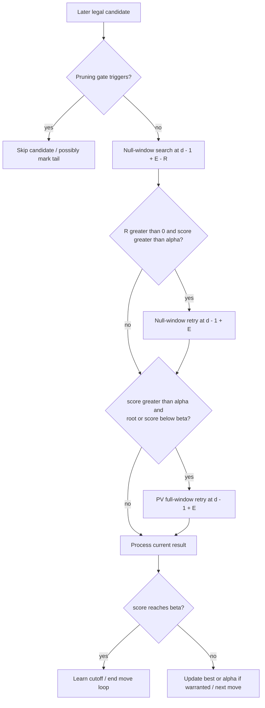
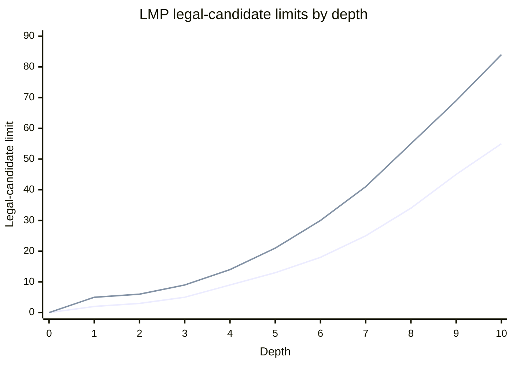

# Search policy reference

[Index](https://github.com/tryingsomestuff/Minic/blob/master/Doc/technical/README.md)
| [Search overview](https://github.com/tryingsomestuff/Minic/blob/master/Doc/technical/search.md)

This chapter is the exact reference for the search policy: eligibility
predicates, depth arithmetic, margins and disabled alternatives. The concepts
behind each technique are explained in the
[search overview](https://github.com/tryingsomestuff/Minic/blob/master/Doc/technical/search.md).
The implementation is
[searcherPVS.hpp](https://github.com/tryingsomestuff/Minic/blob/master/Source/searcherPVS.hpp)
and [searcherQSearch.cpp](https://github.com/tryingsomestuff/Minic/blob/master/Source/searcherQSearch.cpp),
with parameters in
[searchConfig.cpp](https://github.com/tryingsomestuff/Minic/blob/master/Source/searchConfig.cpp)
and switches and precomputed tables in
[searchConfig.hpp](https://github.com/tryingsomestuff/Minic/blob/master/Source/searchConfig.hpp).
All statuses describe the default build; they are not a recommendation to
enable every available branch.

## Kinds of switches

Four kinds of switches appear below:

| Kind | Where | How to change it |
|---|---|---|
| Per-term toggles `enable...` | Local `constexpr bool` in `depthPolicy()`, tested with `if constexpr`; a false term is not compiled. | Edit the constant in searcherPVS.hpp and rebuild. |
| Technique flags `SearchConfig::do...` | `inline const bool` in searchConfig.hpp. They are **not** search-tuning options. | Edit the constant and rebuild. |
| Numeric parameters | `SearchConfig` variables declared `CONST_SEARCH_TUNING`: `const` normally, mutable and (almost all) registered as UCI options when `WITH_SEARCH_TUNING` is defined in [config.hpp](https://github.com/tryingsomestuff/Minic/blob/master/Source/config.hpp); `ttMaxFiftyValideDepth` and `lmrLateExtensionMargin` are never registered. `lmpLimit`/`lmpMaxDepth` are plain `const` and never options. | Tuning build, or edit searchConfig.cpp. |
| Commented-out code | Blocks and lines inside comments. | Restore the code (and, where noted, its parameter). |

The current flags are: `doWindow`, `doPVS`, `doNullMove`, `doFutility`,
`doLMR`, `doLMP`, `doStaticNullMove`, `doThreatsPruning`, `doRazoring`,
`doQDeltaPruning`, `doProbcut`, `doHistoryPruning`, `doCapHistoryPruning`,
`doCMHPruning` and `doIIR` true; `doQFutility` and `doIID` false. The
inventory of all disabled techniques of the engine is in
[implemented but disabled techniques](https://github.com/tryingsomestuff/Minic/blob/master/Doc/technical/disabled-features.md).

## Vocabulary

| Term | Meaning in this engine |
|---|---|
| PV node | Node searched by `pvs<true>`, normally with a window wider than one point. |
| Null window | Window `[alpha, alpha + 1]`: the search only answers "is the score above alpha?". |
| Fail high / fail low | The score reaches `beta` (the node is cut) or stays at or below `alpha`. |
| Cut node | A node expected to fail high. `cutNode` is a hint passed down the tree; the reduced null-window search sets it to true. |
| `ttPV` | `pvnode`, or a valid TT move whose entry carries `B_ttPVFlag`. `formerPV` is `ttPV && !pvnode`. |
| `improving` | Not in check, `height > 1` and the stored static evaluation is at least the one two plies earlier. |
| `evalScoreIsHashScore` | The static estimate `evalScore` was replaced by a TT search score. |
| `lessZugzwangRisk` | The side to move has a piece other than king and pawns (`isNotPawnEndGame`), or mobility above 4. |
| `isKnownEndGame` | Fewer than 5 non-pawn, non-king pieces in total and a material-table entry with a known termination. |
| Reduction / extension | Searching a move `R` plies shallower than normal, or `E` plies deeper. |

## Coordinates and arithmetic

Symbols:

```text
d   remaining depth at this point in PVS, after any IIR
h   relative search height
n   validMoveCount, including legal moves later pruned
E   this move's extension, possibly negative in the singular TT path
R   this move's reduction
X   cumulative extensions argument passed down the line
s   Move2Score(move), an ordering score, not a searched position score
v   evalScore, possibly substituted by a TT search score
g   game phase in [0, 1], 1 in the middlegame and 0 in the endgame
```

An ordinary child receives `d - 1 + E - R` and `h + 1`. The height always
equals the distance from the search root; both `pvs()` and `qsearch()` assert
it on entry:

```cpp
assert(height == p.halfmoves - rootHalfmoves);
```

Searches that revisit the *same* position, the singular exclusion probe and the
null-move verification search, therefore pass `height` unchanged. Because
`height > 1` implies that the position two plies earlier belongs to the current
search, the stack look-backs rely on height alone:

```cpp
pvsData.improving = (!pvsData.isInCheck && height > 1 && stack[p.halfmoves].eval >= stack[p.halfmoves - 2].eval);
...
const MiniMove formerRefutation = height > 1 ? stack[p.halfmoves - 2].threat : INVALIDMINIMOVE;
```

Static evaluations stored in the stack are never TT search scores. A node in
check stores `matedScore(height)`, so a node two plies below a checked node
compares itself with a very low value and is `improving`. Without NNUE, after a
null move the static score is `2 * tempo - parentEval` (guarded by
`height > 0`); this shortcut assumes a symmetric evaluation.

`DepthType` is signed 8-bit and `ScoreType` signed 16-bit. Arithmetic is often
promoted to `int` before the final conversion; a new term must respect both the
resulting depth range and the cumulative-extension range.

## PVS step by step

The exact order of `pvs()`, with the conditions of each step:

1. `timeCheck()` on the main thread or a stoppable co-searcher (every 1024
   nodes, or the node limit if smaller); `stopFlag` returns `STOPSCORE`.
2. If `height >= MAX_DEPTH - 1` or `depth >= MAX_DEPTH - 1`, return `eval()`.
3. Non-root: `interiorNodeRecognizer<pvnode>()` returns `drawScore()` for
   `isRep(p, pvnode)`, `isMaterialDraw(p)` or `fifty >= 101`.
4. `depth <= 0`: return `qsearch(alpha, beta, p, height, seldepth, 0, true, pvnode, isInCheck)`.
   A commented line would instead search checked leaves at depth 1 (a check
   extension at the horizon, disabled by default).
5. Update `seldepth` and the node counter. Non-root: clip to
   `[matedScore(height), matingScore(height + 1)]` and return `alpha` if empty.
   Root: clear `rootScores`.
6. Continuation-history pointers; `pHash = computeHash(p)` XORed with
   `Zobrist::hashMove()` of every excluded move; known-endgame lookup.
7. TT probe with the current depth. Direct cutoff, non-PV only: a deep enough
   entry with `B_alpha && e.s <= alpha`, `B_beta && e.s >= beta` or `B_exact`
   first updates histories for its move (quiet: `updateTables()`, which handles
   only beta and alpha bounds; capture: `updateCap<±1>()`), then returns
   `adjustHashScore(e.s, height)` if `fifty < 92` and not `isKnownEndGame`.
   A PV-node cutoff (`B_exact`, `e.d > 3*depth/2`) is commented out.
8. Late TT cutoffs, non-PV, non-root, also in check (the `!isInCheck` term is
   commented out), with an entry of positive depth:

   ```text
   B_alpha, e.d >= d - 1, e.s + 60 * (d - 1) <= alpha  ->  return alpha
   B_beta,  e.d >= d - 1, e.s - 64 * (d - 1) >= beta   ->  return beta
   ```

9. Syzygy, non-root, no exclusion, piece count <= `MAX_TB_MEN`: a WDL hit
   returns `±2000 + eval` (clamped) for a win/loss, `drawScore()` for a cursed
   win or blessed loss, 0 for a draw.
10. Static evaluation: `matedScore(height)` in check; the null-move shortcut
    without NNUE; the TT entry's evaluation on a TT hit (any entry, game phase
    then taken from the material table); `eval()` otherwise. Stored in
    `stack[p.halfmoves].eval`. On a TT miss, an evaluation-only entry is
    written at depth -2 with bound `B_none`.
11. TT substitution: if `ttHit && e.d > 0 && !isInCheck && !isKnownEndGame` and
    (`B_alpha && e.s < v`, `B_beta && e.s > v` or `B_exact`), then
    `v = adjustHashScore(e.s, height)` and `evalScoreIsHashScore = true`.
12. Correction: `pruningEval` is `v` when substituted, otherwise
    `correctedEval(staticScore) + horizonCorrection(...)` (the horizon term is 0
    by default); `pruningEvalBaseline` is `staticScore` or
    `correctedStaticScore` accordingly.
13. Attack data via `evalFeatures()` when evaluation did not run, danger terms,
    `marginDepth = max(0, d - (evalScoreIsHashScore ? e.d : 0))`, `improving`,
    `lessZugzwangRisk`.
14. Non-PV, non-root, not in check, not `mateFinder`: static null move, threat
    pruning, razoring, null move, ProbCut (below). A commented `!isMateScore(beta)`
    term would further restrict this block.
15. IIR: `doIIR && d >= 3 && !ttHit` gives `d -= 1` (all node types).
    `ttHit` is any entry, including an evaluation-only one. IID (disabled).
16. Clear `killers[height + 1]`; store the null-move `refutation` in
    `stack[p.halfmoves].threat`; compute the BM flag; non-root: compute the
    per-move gates `lmp`, `futility`, `historyPruning`, `CMHPruning`,
    `capHistoryPruning`.
17. Root Syzygy: `probe_root()` success replaces the move list with Fathom's
    single move; on failure the moves are generated normally.
18. TT move (if valid, not excluded, and not at a root whose list came from
    tablebases): singular probe, then search of the TT move.
19. Generation (`GP_quiet` appended to ProbCut captures, else `GP_evasion` in
    check or `GP_all`); empty list returns mate or draw; scoring and the move
    loop.
20. `validMoveCount == 0` returns `alpha` in an exclusion search, else
    `matedScore(height)` in check, else `drawScore()`. Otherwise
    `fifty >= 100` returns `drawScore()`.
21. Correction-history update (below) and TT store at the current (post-IIR)
    depth, with flags `B_ttPVFlag` (`ttPV`), `B_isCheckFlag` (best move gives
    check) and `B_isInCheckFlag`. `bestMove` is preset to the TT move, so an
    alpha-bound entry keeps it.

## Parameterized margins

`Coeff<2,2>` holds per-variant `init`, `slopeDepth`, `slopeGamePhase`,
`minDepth`, `maxDepth` and a two-entry multiplier `bonus`:

```cpp
const auto value = init[idx1]
                 + d * slopeDepth[idx1] 
                 + static_cast<double>(gp) * slopeGamePhase[idx1];
...
return static_cast<ScoreType>(value * bonus[idx2] / 256.0);
```

and `isActive(d, idx1)` is `minDepth[idx1] <= d <= maxDepth[idx1]`. `bonus`
is a factor in units of 1/256, not an additive bonus; the cast truncates toward
zero. The meaning of the indices and of `d` depends on the caller:

| Coefficient | `threshold(d, g, idx1, idx2)` call | `isActive` | init | bonus | slopeDepth | slopeGP | depth range |
|---|---|---|---|---|---|---|---|
| `staticNullMoveCoeff` | `(d, g, hash, improving)` | `(d, hash)` | -15, -32 | 404, 112 | 82, 75 | 149, 21 | 0..6 |
| `threatCoeff` | `(d, g, hash, improving)` | `(d, hash)` | 33, 10 | 259, 261 | 24, 18 | -15, 40 | 0..2 |
| `razoringCoeff` | `(marginDepth, g, hash, improving)` | `(d, hash)` | 123, 119 | 279, 651 | 69, 66 | -22, 17 | 0..2 |
| `futilityPruningCoeff` | `(marginDepth, g, hash, improving)` | `(d, hash)` | 7, 6 | 155, 605 | 161, 170 | -3, -6 | 0..10 |
| `historyPruningCoeff` | `(d, g, improving, cutNode)` | `(d, improving)` | 8, -12 | 247, 306 | -13, 9 | 16, -37 | 0..2 / 0..1 |
| `captureHistoryPruningCoeff` | `(d, g, improving, cutNode)` | `(d, improving)` | 5, 9 | 265, 304 | -121, -126 | -8, 22 | 0..4 / 0..3 |
| `failHighReductionCoeff` | `(marginDepth, g, hash, improving)` | not used | 119, 139 | 303, 233 | -54, 7 | -25, 13 | 0..`MAX_DEPTH` |

Here `hash` is `evalScoreIsHashScore`. For example, the static-null margin with
a static evaluation, not improving, at depth 4 and phase 0.5 is
$(-15 + 4\cdot 82 + 0.5\cdot 149)\cdot 404/256 = 611.5 \to 611$; when improving
the factor 112/256 shrinks it to 169, so an improving node is pruned much
earlier. Razoring and futility do the opposite: their improving factor is
larger, so improving nodes are pruned later.

## Node-level forward pruning

All of this section requires a non-PV, non-root node, not in check, and
`mateFinder` false.

**Static null move**: `doStaticNullMove`, `!isMateScore(pruningEval)`,
`lessZugzwangRisk`, `staticNullMoveCoeff.isActive(d, hash)`; with
`margin = threshold(d, g, hash, improving)`, return `pruningEval - margin` if
`pruningEval > beta + margin`.

**Threat pruning**: `doThreatsPruning`, the same guards plus
`!goodThreats[opponent]`, using `threatCoeff`; same return.

**Own-threat pruning** (disabled by default, commented out with
`ownThreatCoeff`): with `!goodThreats[side to move]` and
`evalScore < alpha - margin` at depth 0..2, it would return `alpha`.

**Razoring**: `doRazoring`, `razoringCoeff.isActive(d, hash)`,
`rAlpha = alpha - threshold(marginDepth, g, hash, improving)` and
`pruningEval <= rAlpha`. Without `haveThreats[side to move]`, return `rAlpha`;
otherwise `qScore = qsearch(alpha, beta, ...)` and return it if
`qScore <= alpha`. A commented line would return `qScore` unconditionally when
the estimate is a TT score.

### Null-move pruning and verification

Eligibility: `doNullMove`, `!subSearch`, `d >= 2`, `lessZugzwangRisk`, no
excluded move, `pruningEval == beta || pruningEval >= beta + 18`,
`pruningEval >= pruningEvalBaseline`, the previous move is not a null move, and
`height >= nullMoveMinPly || nullMoveVerifColor != p.c`. A commented
`!isKnownEndGame` term is not active. The code:

```cpp
const DepthType R = SearchConfig::nullMoveReductionInit +
                  depth / SearchConfig::nullMoveReductionDepthDivisor + 
                  std::min((pruningEval - beta) / SearchConfig::nullMoveDynamicDivisor, 7); // adaptative
const DepthType nullDepth = std::max(0, depth - R);
Position& pN = stack[p.halfmoves + 1].p;
pN = p;
applyNull(*this, pN);
...
ScoreType nullscore   = -pvs<false>(-beta, -beta + 1, pN, nullDepth, height + 1, nullPV, seldepth, extensions, pvsData.isInCheck, !pvsData.cutNode);
if (stopFlag) return STOPSCORE;
TT::Entry nullEThreat;
TT::getEntry(*this, pN, computeHash(pN), 0, nullEThreat);
if (nullEThreat.h != nullHash && nullEThreat.m != INVALIDMINIMOVE) refutation = nullEThreat.m;
if (isMatedScore(nullscore)) pvsData.mateThreat = true;
if (nullscore >= beta) { // verification search
   if ( (!pvsData.lessZugzwangRisk || depth > SearchConfig::nullMoveVerifDepth) && nullMoveMinPly == 0){
      stats.incr(Stats::sid_nullMoveTry3);
      nullMoveMinPly = height + 3*nullDepth/4;
      nullMoveVerifColor = p.c;
      nullscore = pvs<false>(beta - 1, beta, p, nullDepth, height, nullPV, seldepth, extensions, pvsData.isInCheck, false);
      nullMoveMinPly = 0;
      nullMoveVerifColor = Co_None;
      if (stopFlag) return STOPSCORE;
      if (nullscore >= beta ) return stats.incr(Stats::sid_nullMove2), nullscore;
   }
   else {
      return stats.incr(Stats::sid_nullMove), (isMateScore(nullscore) ? beta : nullscore);
   }
}
```

with `nullMoveReductionInit` 5, `nullMoveReductionDepthDivisor` 6 and
`nullMoveDynamicDivisor` 147. Because eligibility already requires
`lessZugzwangRisk`, the first operand of the verification test is always false:
verification happens only for `d > 6` (and not inside another verification);
shallower fail-highs return directly, a mate score being replaced by `beta`.
During verification the same side cannot try a null move again below height
`height + 3*nullDepth/4`. A failed verification falls through to ProbCut and
the move loop. The child's TT move becomes `refutation`, used by the
threat-escape ordering bonus (only when it is a capture) and by the BM flag.

### ProbCut

With `betaPC = beta + 124 - 53 * improving`, ProbCut runs when `doProbcut`,
`d >= 10`, `!isMateScore(beta)`, `haveThreats[side to move]`,
`cutNode || staticScore >= betaPC`, and not
`(validTTmove && e.d >= d/3 + 1 && e.s < betaPC)`. It generates `GP_cap`,
scores the list with SEE, and picks moves in order; it skips the TT move and
bad captures, counts only legally applied moves, and stops after 5. Each move
is tested with `-qsearch(-betaPC, -betaPC + 1, ...)`; if that reaches `betaPC`,
it is confirmed by `-pvs<false>(-betaPC, -betaPC + 1, child, d / 3, ..., !cutNode)`,
and a confirmed score is returned. The capture-history update and TT store that
follow a success are commented out (disabled by default). The generated
captures stay in `moves` and keep their scores in the main loop.

### IID (disabled)

`doIID` is false. If enabled, a node with no valid TT move at a PV node with
`d >= 7` (`iidMinDepth`) or a cut node with `d >= 10` (`iidMinDepth2`) would run
`pvs<pvnode>(alpha, beta, p, d / 2, ...)` on the same position, re-read the TT
entry, refresh the TT flags and possibly the TT score substitution.
`iidMinDepth3` is declared but unused.

## Three move-search paths

| Path | Budget and conditions |
|---|---|
| TT move | Searched before generation with `pvs<pvnode>(-beta, -alpha, ..., d - 1 + E, ..., !cutNode)`, `E` from the singular probe. Never passes through `depthPolicy()`. |
| Early generated move | `validMoveCount < 2` after applying it (or `doPVS` false): full window, `pvs<pvnode>`, `depthPolicy(..., false)`, cut-node hint false. |
| Later generated move | Pruning gates, then `depthPolicy(..., isReductible)`, reduced null window and retries. |

A rejected illegal candidate does not increment `validMoveCount`; a legal but
pruned candidate does. A legal TT move counts as the first legal move, so the
first generated move already has `n == 2` and takes the later path: only one
move per node (the TT move, or else the first legal generated move) is
"early". The already tried TT move is skipped in the generated list.

The later-move predicates are:

```cpp
const bool isPrunable           = /*pvsData.isNotPawnEndGame &&*/ !pvsData.isAdvancedPawnPush && !isMateScore(alpha) && !killerT.isKiller(*it, height) && !DynamicConfig::mateFinder;
const bool isReductible         = SearchConfig::doLMR && depth >= SearchConfig::lmrMinDepth && /*pvsData.isNotPawnEndGame &&*/ !pvsData.isAdvancedPawnPush && !DynamicConfig::mateFinder;
const bool isPrunableStd        = isPrunable && pvsData.isQuiet;
const bool isPrunableStdNoCheck = isPrunableStd && noCheck;
const bool isPrunableCap        = isPrunable && Move2Type(*it) == T_capture && noCheck;
const bool isPrunableBadCap     = isPrunableCap && isBadCap(*it);
```

`noCheck` means neither the parent nor the child is in check. A killer is
protected from pruning, not from LMR. The advanced-pawn test is a pawn whose
destination rank index is below 2 or above 5 (ranks 1, 2, 7 and 8), which for
either color means reaching its own seventh or eighth rank; it is not a
passed-pawn test.
`isQuiet` is `T_std && !isNoisy()`, and `isNoisy()` merely tests
`Move2Type(m) != T_std`; a commented pawn/knight fork detection in `isNoisy()`
is disabled. Castling, promotions and en passant are therefore never "quiet".

## Root specifics

At the root there is no draw recognition, no mate-distance pruning, no TT
cutoff, no node-level pruning, no singular probe and no per-move pruning
(`lmp`, `futility` and the history gates stay false, and both SEE filters test
`!rootnode`); LMR applies. Every root move's score is appended to `rootScores`,
and `previousBest` records the move that improved `bestScore`, which gives the
root-best ordering bonus in the next iteration. The PV re-search condition is
`score > alpha && (rootnode || score < beta)`, so at the root a fail-high is
also re-searched with the full window.

Both move paths contain a root shortcut returning
`alpha - failLowRootMargin` (118) for a score that far below alpha. It is
inert: it sits in the `else` of `if (score > bestScore)`, and since `bestScore`
starts at `matedScore(0)` the first searched move, the only one for which the
shortcut is tested (TT move, or `earlyMove`), always takes the `if` branch.

## Base LMR table

The base reduction is filled once at start-up in `lmrReduction`:

```cpp
ret[d][m] = DepthType(my_log2(d * 1.6) * my_log2(m * 1) * 0.4);
```

For positive indices,

$$
L(d,n)=\operatorname{trunc}\!\left(0.4\,\ell(1.6d)\,\ell(n)\right),
\qquad \ell(x)=\operatorname{my\_log2}(x)\simeq\ln(x).
$$

Despite its name, `my_log2()` approximates the **natural logarithm**: it halves
`x` below 2, sums the odd-power series of $2\operatorname{artanh}(y)$ with
$y = (x - 1)/(x + 1)$ and adds back the removed multiples of $\ln 2$. Replacing
it with `std::log2()` would change the table. Row and column 0 are zero, and so
is column 1 ($\ln 1 = 0$); indices are capped at `MAX_DEPTH - 1` and
`MAX_MOVE - 1`. For example $L(8,2) = 0$ and $L(8,8) = 2$.

## Active ordinary-quiet reduction terms

Only `T_std` enters this branch:

```cpp
reduction += SearchConfig::lmrReduction[depthIdx][moveIdx];
...
reduction += static_cast<int>(!pvsData.improving);
...
reduction += static_cast<int>(pvsData.ttMoveIsCapture);
...
const bool likelyFailHigh = pvsData.cutNode &&
   evalScore - SearchConfig::failHighReductionCoeff.threshold(
      pvsData.marginDepth, evalData.gp, pvsData.evalScoreIsHashScore, pvsData.improving) > pvsData.beta;
reduction += static_cast<int>(likelyFailHigh);
...
const int hScore = HISTORY_DIV(2 * Move2Score(m));
reduction -= std::min(3, hScore);
...
reduction -= static_cast<int>(pvsData.formerPV || pvsData.ttPV);
...
reduction -= static_cast<int>(pvsData.isKnownEndGame);
```

that is

```text
R = L[d][n] + !improving + ttMoveIsCapture + likelyFailHigh
  - min(3, HISTORY_DIV(2 * s)) - (formerPV || ttPV) - knownEndgame
```

`likelyFailHigh` uses `evalScore` (possibly a TT score, uncorrected), not
`pruningEval`. With `failHighReductionCoeff` at depth 8, phase 0.5, static
evaluation, not improving, the threshold is
$(119 - 8\cdot 54 - 0.5\cdot 25)\cdot 303/256 \approx -385$, so a cut node
counts as likely to fail high as soon as $v + 385 > \beta$: a negative margin
is legitimate here.

`HISTORY_DIV(x)` is an arithmetic right shift by 10: score -100 gives
`(-200 >> 10) == -1` while +100 gives 0. The positive side is capped at 3 and
the negative side is not clamped. `s` is the whole ordering score (see
[move ordering](https://github.com/tryingsomestuff/Minic/blob/master/Doc/technical/move-ordering.md)):
a first killer (1900) gives `HISTORY_DIV(3800) == 3`, the maximum relief,
while a generic quiet with an ordering score of -600 gets +2.

`ttPV` includes the PV-node flag, so the former-PV prudence already protects
ordinary PV nodes even though `enableReduceLessAtPVNode` is false.

### Worked quiet example

At depth 8 with the eighth legal candidate, the base is 2. Not improving, a
capture TT move and a likely fail-high add 3; an ordering score of 1100 removes
`HISTORY_DIV(2200) = 2`; TT-PV context removes 1:

```text
R = 2 + 1 + 1 + 1 - 2 - 1 = 2
nextDepth = 8 - 1 - 2 = 5
```

If the reduced score exceeds alpha, the retry uses depth 7.

## Active ordinary-capture reduction terms

Only `T_capture` (not en passant, not capture-promotion) enters this branch:

```cpp
reduction += SearchConfig::lmrReduction[depthIdx][moveIdx];
...
const int hScore = HISTORY_DIV(SearchConfig::lmrCapHistoryFactor *
   historyT.getCaptureHistory(p.board_const(Move2From(m)), to, p.board_const(to)));
reduction -= std::max(-2, std::min(2, hScore));
...
reduction += static_cast<int>(isBadCap(m) && reduction > 1);
...
reduction -= static_cast<int>(pvsData.pvnode);
...
reduction -= static_cast<int>(pvsData.improving);
```

`lmrCapHistoryFactor` is 9. `isBadCap(m)` is
`badCapScore(m) < DynamicConfig::badCapLimit` (runtime option, default -80),
where `badCapScore(m) = Move2Score(m) + 7000`: for a capture that the scorer
demoted by `-2 * 7000` (SEE below `badCapLimit`), this recovers roughly
`SEE + PST hint`; for any other capture it is around 14000 and never "bad".
The bad-capture increment is evaluated after the history adjustment and before
the PV/improving deductions; changing this order changes behavior.

For other move types `R` stays 0, though the normalization below still applies
when the move is reducible.

## Disabled reduction inventory

All disabled by default; each is a local `constexpr bool` of `depthPolicy()`.

| Switch suffix after `enable` | Branch arithmetic if enabled | Remark |
|---|---|---|
| `ThreadBaseReduction` | Quiet `R += id() % 2`. | Worker asymmetry. |
| `AggressiveRandomReduction` | Quiet `R++` if `(nodes + qnodes) % 128 > 128 - factor * validQuietMoveCount`. | The local factor is 0, so the condition is never true; its tuning option is commented out. |
| `MobilityBasedReduction` | Quiet `R += (opponentMobility - ownMobility) / 16 < 0`, outside check. | Reduces more when the side to move has clearly more mobility. |
| `ReduceLessWhenInCheck` | Quiet `R -= isInCheck`. | Concerns moves from a checked node. |
| `ReduceLessWhenGivingCheck` | Quiet `R -= isCheck`. | Uses the applied child's check state. |
| `ReduceLessAtPVNode` | Quiet `R -= pvnode`. | Overlaps the enabled `ttPV` prudence. |
| `ReduceLessAfterAlphaUpdateAll` | Quiet `R -= (!cutNode && alphaUpdated)`. | |
| `ReduceLessOnSingularTT` | Quiet `R -= ttMoveSingularExt`. | Other quiets at a node whose TT move was singular. |
| `ReduceLessOnTheirTurn` | Quiet `R -= theirTurn` (odd height). | |
| `ReduceLessOnEmergencyDefence` | Quiet `R -= isEmergencyDefence`. | The flag is forced false in `pvs()`: no effect even if enabled. |
| `ReduceLessOnAdvancedPawnPush` | Quiet `R -= 2 * isAdvancedPawnPush`. | `isReductible` already excludes such moves: no effect. |
| `CaptureReduceLessIfTTMoveIsCap` | Capture `R -= ttMoveIsCapture`. | |
| `CaptureReduceLessOnFormerPV` | Capture `R -= (formerPV || ttPV)`. | |
| `CaptureReduceLessOnAdvancedPawn` | Capture `R -= 2 * isAdvancedPawnPush`. | Also excluded by `isReductible`. |

The enabled toggles are `StdBaseLMRReduction`, `StdNotImprovingReduction`,
`StdTTMoveIsCaptureReduction`, `StdFailHighReduction`, `StdHistoryReduction`,
`StdFormerPVPrudence`, `StdKnownEndgamePrudence`, `CapBaseLMRReduction`,
`CapHistoryReduction`, `CaptureBadCapExtraReduction`, `CapPVNodePrudence` and
`CapImprovingPrudence`.

## Generic extension inventory: all disabled

`tryExtension()` adds one ply only while `E == 0`, so enabled predicates would
be tested in the order below and never accumulate. The whole block requires
`!validTTmove`, a property of the **node**: with a TT move, no generated move
can be extended. These extensions apply to early and later moves alike, but on
a reducible move the normalization below cancels any net extension, so in
practice only the early move could gain a ply. All toggles are false.

| Switch suffix after `enable` | Predicate if enabled |
|---|---|
| `CheckQuietExtension` | Gives check and (`earlyMove` or quiet with `s >= 1024`). |
| `InCheckExtension` | Early move from a position in check. |
| `BMExtension` | Botvinnik-Markoff flag (below). |
| `MateThreatExtension` | Early move with a null-move mate threat. |
| `QueenThreatExtension` | Early quiet queen move, the first own queen is attacked, `SEE_GE(m, -80)`. |
| `CastlingExtension` | Castling. |
| `RecaptureExtension` | Previous move an ordinary capture, current move not "bad" and same corrected destination (no explicit capture-type test of the current move). |
| `GoodHistoryExtension` | Quiet with `512 < s <= 1024` (`historyExtensionThreshold`). |
| `CMHExtension` | Quiet with distance-1 continuation history >= 768. |

The Botvinnik-Markoff flag tests whether the opponent's threat found by the
null move is the same as two plies earlier (the intermediate move did not
address it). It is computed only with NNUE:

```cpp
const MiniMove formerRefutation = height > 1 ? stack[p.halfmoves - 2].threat : INVALIDMINIMOVE;
pvsData.BMextension = DynamicConfig::useNNUE && height > 1 && 
                      isValidMove(refutation) && isValidMove(formerRefutation) &&
                      (sameMove(refutation, formerRefutation) ||
                       (isCapture(refutation) && Move2To(refutation) == correctedMove2ToKingDest(formerRefutation)));
```

Computing the flag does not enable the extension. The mate threat comes from a
mated score in the null-move search: evidence from a selective search, not a
proof.

## Generic normalization and retries

For reducible moves, `depthPolicy()` ends with:

```cpp
if (extension - reduction > 0) reduction = extension;
// clamp to depth = 0
if (static_cast<int>(depth) - 1 + extension - reduction <= 0) reduction = static_cast<int>(depth) - 1 + extension;
```

so a reducible move can neither be net-extended nor reduced below depth 0. The
child budgets are

$$
d_{\mathrm{child}}=d-1+E-R,\qquad
d_{\mathrm{unreduced}}=d-1+E,
$$

and the searches are:

```text
reduced:   -pvs<false>(-alpha-1, -alpha, child, d-1+E-R, cutNode=true)
retry:     -pvs<false>(-alpha-1, -alpha, child, d-1+E,   cutNode=!parentCutNode)   if R > 0 && score > alpha
PV retry:  -pvs<true> (-beta,    -alpha, child, d-1+E,   cutNode=false)            if score > alpha && (root || score < beta)
```

The child PV is cleared between attempts.



No branch varies the retry depth according to how far the reduced result
exceeded alpha. Commented history updates after the unreduced retry (rewarding
or penalizing the move by whether it beat alpha) are disabled by default.

## Singular TT policy

Eligibility: `DynamicConfig::level > 80`, no exclusion in progress,
`d >= singularExtensionDepth` (8), non-root, `!isMateScore(e.s)`, bound
`B_exact` or `B_beta`, and `e.d >= d - singularExtensionDepthMinus` (5). The
probe (quoted in the
[overview](https://github.com/tryingsomestuff/Minic/blob/master/Doc/technical/search.md#tt-move-singular-extensions-and-multi-cut))
searches the same position at `d / 2`, height unchanged, window
`[betaC - 1, betaC]` with `betaC = e.s - 2*d`, excluding the TT move and
keeping the parent's cut-node hint. The excluded move is XORed into the hash
(`pHash ^= Zobrist::hashMove(it)`), so the probe neither reads nor overwrites the
full node's TT entry.

| Exclusion outcome | Consequence |
|---|---|
| `score < betaC` | `E = 1`, `ttMoveSingularExt = true`. |
| also `score < betaC - 4*d && X <= 6` | `E = 2`. |
| else `betaC >= beta` | Multi-cut: return `betaC`. |
| else `e.s >= beta` | `E = -2 + pvnode` (-2 non-PV, -1 PV). |
| else `e.s <= alpha` | `E = -1`. |
| otherwise | `E = 0`. |

`X` is signed and includes negative extensions; the guard limits only the
second ply. Disabled by default (commented out): a third ply when
`score < betaC - 8*d`, the TT move is not a capture and `X <= 6`; before the
`e.s >= beta` negative extension, a `d - 4` exclusion search returning `beta`
when it exceeds beta; and a cut-node branch setting `E = -1`. The commented
`extensions <= 6` guard on the first ply is also inactive.

The child position is copied, the move applied and the evaluator initialized
only after the probe, because the probe reuses the same stack slots.

## Per-move pruning equations

The per-node gates, computed once before the TT move (non-root only):

```cpp
pvsData.lmp = SearchConfig::doLMP && depth <= SearchConfig::lmpMaxDepth;
// futility
const ScoreType futilityScore = alpha - SearchConfig::futilityPruningCoeff.threshold(pvsData.marginDepth, evalData.gp, pvsData.evalScoreIsHashScore, pvsData.improving);
pvsData.futility = SearchConfig::doFutility && SearchConfig::futilityPruningCoeff.isActive(depth, pvsData.evalScoreIsHashScore) && pruningEval <= futilityScore;
// history pruning
pvsData.historyPruning = SearchConfig::doHistoryPruning && pvsData.isNotPawnEndGame && SearchConfig::historyPruningCoeff.isActive(depth, pvsData.improving);
// CMH pruning
pvsData.CMHPruning = SearchConfig::doCMHPruning && pvsData.isNotPawnEndGame && depth < SearchConfig::CMHMaxDepth[pvsData.improving];
// capture history pruning
pvsData.capHistoryPruning = SearchConfig::doCapHistoryPruning && pvsData.isNotPawnEndGame && SearchConfig::captureHistoryPruningCoeff.isActive(depth, pvsData.improving);
```

For a later move, in this order:

1. `skipQuiet && isPrunableStdNoCheck`: skip.
2. `skipCap && isPrunableBadCap`: skip.
3. If `isPrunableStdNoCheck`:
   - `futility`: set `skipQuiet`, skip;
   - `lmp && n > lmpLimit[improving][d + depthCorrection]`: set `skipQuiet`, skip;
   - `historyPruning && s < historyPruningCoeff.threshold(d, g, improving, cutNode)`:
     set `skipQuiet`, skip;
   - `CMHPruning && isCMHBad(..., CMHMargin = -256)`: skip this move only
     (`isCMHBad()` reads the distance-1 entry; a missing context is never bad).
4. Otherwise:
   - `capHistoryPruning && isPrunableCap` and capture history below
     `captureHistoryPruningCoeff.threshold(d, g, improving, cutNode)`: skip;
   - non-root `isPrunableBadCap`: with `futility`, set `skipCap` and skip;
     else if `badCapScore < -(65 + 180 * (d - 1 + max(0, goodAttack - underAttack) / 8))`,
     set `skipCap` and skip.
5. `depthPolicy()`; then for `isPrunableStdNoCheck` at a non-root node, with a
   freshly computed SEE:
   `SEE < -(32 + 61 * (nextDepth - 1) * (nextDepth + max(0, goodAttack - underAttack) / 11))`:
   skip. A commented line reducing a quiet with negative SEE by one more ply is
   disabled by default.

`goodAttack = danger[opponent] / 183` and `underAttack = danger[own] / 183`.
Two arithmetic consequences of the quiet SEE formula: at `nextDepth == 1` the
threshold is -32 whatever the danger; at `nextDepth == 0` with
`k = max(0, goodAttack - underAttack) / 11 >= 1` the threshold becomes
`61k - 32 > 0`, so almost every quiet is pruned at the frontier of an attack.

`lmpLimit`, indexed by `improving` and nominal depth (`depthCorrection` is
always 0):

| Depth | 0 | 1 | 2 | 3 | 4 | 5 | 6 | 7 | 8 | 9 | 10 |
|---|---|---|---|---|---|---|---|---|---|---|---|
| Not improving | 0 | 2 | 3 | 5 | 9 | 13 | 18 | 25 | 34 | 45 | 55 |
| Improving | 0 | 5 | 6 | 9 | 14 | 21 | 30 | 41 | 55 | 69 | 84 |



The lower curve is non-improving. The count compared with the limit is the
total legal-move count `n`, not the quiet count.

## Quiescence reference

`qsearch(alpha, beta, p, height, seldepth, qply, qRoot, pvnode, isInCheckHint)`:

1. Return `eval()` at `height >= MAX_DEPTH - 1`; `STOPSCORE` on `stopFlag`;
   count a qnode; mate-distance clipping; update `seldepth`.
2. TT probe at depth -2. `isInCheck` comes from the hint, else from the
   entry's `B_isInCheckFlag` or `isPosInCheck()`. `hashDepth` is 0 when in
   check or at `qRoot`, -1 otherwise. Cutoff when `e.d >= hashDepth`,
   non-PV, `fifty < 92` and the bound proves the window.
3. A valid TT move is usable when in check or when it is a capture.
4. Static score: `matedScore(height)` in check; the null-move shortcut without
   NNUE; the TT evaluation on a hit (game phase forced to 0.5 for ordering);
   `eval()` otherwise. `qsearchEval = correctedEval(staticScore)`. On a miss
   outside check, an evaluation-only entry is written at depth -2.
5. Stand pat: return `qsearchEval` if `>= beta`, raise alpha if above it.
6. Outside check, a TT score with a compatible bound (`B_alpha && e.s <= v`,
   `B_beta && e.s >= v`, `B_exact`) replaces `evalScore` and `qsearchEval`
   (uncorrected); this happens after the stand-pat test.
7. `bestScore = qsearchEval`; try the usable TT move. It bypasses the
   recapture-only, SEE and delta filters of step 9, which apply only to
   generated moves.
8. Generate `GP_evasion` in check, `GP_cap` otherwise; score without SEE
   (`useSEE` false: MVV-LVA, recapture bonus, capture history); pick with
   `pickNext()` (no lazy threshold: `lazySortThresholdQS` is unused).
9. Outside check, per move: if `qply > 5` and the last move was a capture,
   only captures on its destination; (disabled) qsearch futility; skip if
   `SEE < seeQThreshold` (-50); at non-`ttPV` nodes skip if
   `SEE <= 20 && qsearchEval + 169 < alpha`, and return `beta` if
   `SEE >= 162 && qsearchEval + 47 > beta`.
10. Children get `qply + 1`, or 0 after a node in check, `qRoot` false and
    `pvnode` false.
11. No legal evasion: `matedScore(height)`; else `fifty >= 100` returns
    `drawScore()`. Store at `hashDepth` with `B_ttPVFlag` and
    `B_isInCheckFlag` flags.

Qsearch futility (`doQFutility`, disabled by default) would skip, after at
least one legal move, a capture when
`qsearchEval + qfutilityMargin[hash] (1024) + captured value (+ queen minus pawn for a capture-promotion) <= alphaInit`.

## Learning from a cutoff

When a move reaches `beta` and the node is not in check:

```cpp
const DepthType bonusDepth = depth + (score > beta + SearchConfig::betaMarginDynamicHistory);
if (pvsData.isQuiet /*&& depth > 1*/ /*&& !( depth == 1 && validQuietMoveCount == 1 )*/) { // quiet move history
   // increase history of this move
   updateTables(*this, p, bonusDepth, height, bestMove, TT::B_beta, pvsData.cmhPtr);
   // reduce history of all previous
   for (auto it2 = moves.begin(); it2 != moves.end() && !sameMove(*it2, bestMove); ++it2) {
      if (Move2Type(*it2) == T_std)
         historyT.update<-1>(bonusDepth, *it2, p, pvsData.cmhPtr);
   }
}
else if ( isCapture(bestMove)){ // capture history
   historyT.updateCap<1>(bonusDepth, bestMove, p);
   for (auto it2 = moves.begin(); it2 != moves.end() && !sameMove(*it2, bestMove); ++it2) {
      if (isCapture(*it2))
         historyT.updateCap<-1>(bonusDepth, *it2, p);
   }
}
```

`betaMarginDynamicHistory` is 170. `updateTables()` with `B_beta` stores the
killer and the counter move and applies a positive history update. The malus
loop walks the list prefix before the best move, which includes pruned moves
and, with lazy sorting, follows the current list layout. A TT-move cutoff uses
the same bonus depth but no malus loop. The step is `HSCORE(depth)`,
$4\min(d,16)^2$, and entries move through `HISTORY_UPDATE`:

```cpp
const int boundedBonus = std::clamp(bonus, -static_cast<int>(HISTORY_MAX), static_cast<int>(HISTORY_MAX));
const int updated = item + boundedBonus - HISTORY_DIV(item * Abs(boundedBonus));
```

so an entry stays in $[-1024, 1024]$; see
[tables and history](https://github.com/tryingsomestuff/Minic/blob/master/Doc/technical/tables-and-history.md).

Correction history is updated after the move loop when not in check, the best
move is valid and not a capture or promotion, the best score is not a mate,
and not (`B_beta && bestScore <= correctedStaticScore`) nor
(`B_alpha && bestScore >= correctedStaticScore`). Only nodes reaching the end
of `pvs()` learn: a cutoff inside the move loop does, whereas TT cutoffs,
node-level pruning returns, multi-cut and a TT-move cutoff do not.

## Other disabled or inert search code

All disabled by default:

| Item | State | Effect if restored |
|---|---|---|
| Root fail-low shortcut | Inert (unreachable `else` branch) | Moving it before the `score > bestScore` test would return `alpha - 118` for a bad first root move. |
| Check at the horizon | Commented in `pvs()` | `depth <= 0` in check would search at depth 1 instead of entering qsearch. |
| PV-node TT cutoff | Commented | Exact entry deeper than `3*d/2`, `fifty < 92`. |
| TT store of Syzygy hits | Commented | Store WDL results at `MAX_DEPTH`. |
| Root tablebase move set | Commented in [egt.cpp](https://github.com/tryingsomestuff/Minic/blob/master/Source/egt.cpp) | Keep every root move preserving the WDL result instead of Fathom's single move. |
| Danger selectivity | `isDangerPrune`, `isDangerForwardPrune`, `isDangerRed` only count statistics | Thresholds `dangerLimit*` (16) have no search effect. |
| `depthCorrection` | Emergency flags forced false, asymmetry and situation terms 0 | Would shift the LMP index. `lmpLimit` has 11 columns, so a correction of 1 at depth 10 would index out of bounds: clamp the index before re-enabling. |
| Partial sorting off | `USE_PARTIAL_SORT` is defined; the alternative `pvs()` branch calls `MoveSorter::scoreAndSort(moves)` without a sorter object | Needs fixing before disabling partial sorting. |
| Horizon correction | `WITH_HORIZON_CORRHIST` undefined | `horizonCorrection()` returns 0. |
| Beta-cut statistics | `WITH_BETACUTSTATS` undefined | Statistics only, via `updateStatBetaCut()`. |
| Unused parameters | `nullMoveMargin2`, `iidMinDepth3` (tuning options) and `lmrLateExtensionMargin` (not even an option) | Declared but read nowhere. |
| Eligibility tweaks | Commented terms: `isNotPawnEndGame` in `isPrunable`/`isReductible`, `!isKnownEndGame` for null move and ProbCut, `+2*rootnode` in `earlyMove` | No pruning/reduction in pawn endgames; no null move or ProbCut in recognized endgames; three "early" (unreduced, full-window) moves at the root. |
| Classic qsearch delta margin | `qDeltaMargin()`/`bestCapture()` in searcherQSearch.cpp have no caller | Margin for node-level delta pruning: a pawn (a queen if the side to move has a pawn on its seventh rank) plus a queen if the opponent has one, else a rook; a stand pat that far below alpha would allow an immediate return. |
| Evasions in `qsearchNoPruning()` | Commented `GP_all` generation in check | The developer-tool qsearch would search evasions instead of captures only when in check. |
| Parameters of disabled code | `historyExtensionThreshold`, `qfutilityMargin`, `iidMinDepth`, `iidMinDepth2`, `lazySortThresholdQS` | Only meaningful once their branch is enabled. |

## Experiment discipline

Enabling a switch is not enough if its upstream signal is forced to zero, its
caller excludes every eligible move, or an enabled term duplicates it. Record
candidate/search/prune counts separately; compare reduction histograms, retry
frequency and exact selected depths under fixed-node tests. A safe experiment
also preserves score-domain separation (static, corrected, TT scores),
excluded-move hashing, narrow-type limits and same-position stack ownership.
Use match testing for strength conclusions.
