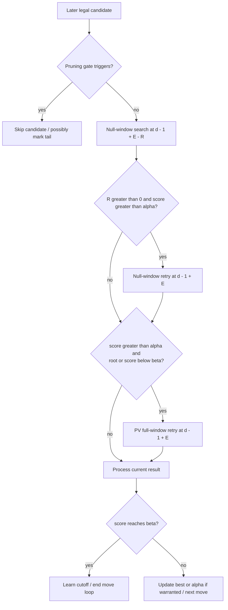
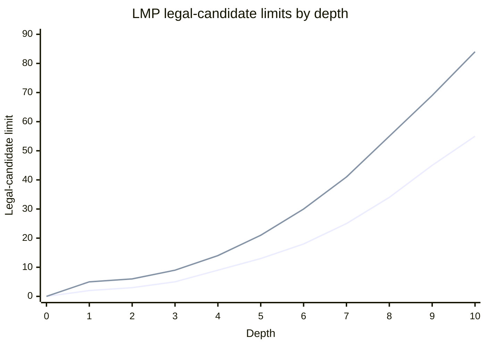

# Search policy reference

[Index](https://github.com/tryingsomestuff/Minic/blob/master/Doc/technical/README.md)
| [Search overview](https://github.com/tryingsomestuff/Minic/blob/master/Doc/technical/search.md)

This chapter specifies the actual depth arithmetic, eligibility predicates and
disabled alternatives. The main implementation is
[searcherPVS.hpp](https://github.com/tryingsomestuff/Minic/blob/master/Source/searcherPVS.hpp),
with parameters in
[searchConfig.cpp](https://github.com/tryingsomestuff/Minic/blob/master/Source/searchConfig.cpp)
and precomputed tables in
[searchConfig.hpp](https://github.com/tryingsomestuff/Minic/blob/master/Source/searchConfig.hpp).
All statuses refer to the documented snapshot, not a recommendation to enable
every available branch.

## Coordinates and arithmetic

Use these symbols:

```text
d   remaining depth at this point in PVS, after any IIR
h   relative search height
n   validMoveCount, including legal moves later pruned
q   validQuietMoveCount, counting ordinary quiet candidates
E   this move's extension, possibly negative in the singular TT path
R   this move's reduction
X   cumulative extensions argument passed down the line
s   Move2Score(move), an ordering score, not a searched position score
v   evalScore, possibly substituted by a TT search score
g   game phase in [0, 1]
```

An ordinary child receives `d - 1 + E - R` and `h + 1`. Exclusion and
verification searches can recurse on the same position, so absolute game ply
need not advance along with their height argument.

`DepthType` is signed 8-bit. Arithmetic is frequently promoted to `int` before
the final conversion. A new term must respect both the resulting depth range
and the cumulative-extension range; a valid-looking expression can overflow a
narrow result if inserted before the existing guards.

## Three move-search paths

| Path | Budget and conditions |
|---|---|
| TT move | Tried separately before ordinary generation; child depth `d - 1 + singularExtension`. Does not pass through generic LMR. |
| First eligible generated move | `validMoveCount < 2`, or PVS globally disabled; full window and `depthPolicy(..., false)`. Generic extensions could apply, but LMR does not. |
| Later generated move | Pruning gates first, then `depthPolicy(..., isReductible)`, reduced null window, possible unreduced and full-window retries. |

An already tried TT move is skipped in the generated list. A rejected illegal
candidate does not increment the legal count; a legal but pruned candidate
does. Thus the LMR table's move index is not simply "number of recursive calls
already made".

The later-move predicates are:

```text
isPrunable =
    !advancedPawnPush && !mateScore(alpha)
    && !currentHeightKiller && !mateFinder

isReductible =
    doLMR && d >= lmrMinDepth
    && !advancedPawnPush && !mateFinder
```

These are intentionally different. A killer is protected from these pruning
branches, but that does not by itself exempt it from LMR. The current
advanced-pawn test is based on piece kind and destination rank `< 2` or `> 5`;
it is not a passed-pawn test.

`isQuiet` currently means `T_std && !isNoisy()`, and `isNoisy()` merely tests
whether the type is not `T_std`. Commented pawn/knight fork detection is not
active. Promotions, castling and EP are not ordinary quiets by this definition.

## Base LMR table

For positive depth/move indices:

$$
L(d,n)=\operatorname{trunc}\!\left(0.4\,\ell(1.6d)\,\ell(n)\right),
\qquad \ell(x)=\operatorname{my\_log2}(x)\simeq\ln(x).
$$

The helper computes an approximation of the **natural logarithm**, despite its
name. It repeatedly halves `x` into a smaller interval, uses the odd-power
series with `y = (x - 1) / (x + 1)`, then adds the removed multiples of `ln(2)`.
Replacing it with `std::log2()` would change the table, not merely optimize it.

Indices are capped at `MAX_DEPTH - 1` and `MAX_MOVE - 1`. The table's zero
row/column remains zero. It is calculated once, not recalculated per move.

Algorithmic motivation: depth makes shallow inspection affordable and later
move rank suggests lower probability of improving alpha. Both are heuristic
priors; reduced fail-lows can still hide good moves.

## Active ordinary-quiet reduction terms

Only `T_std` enters this branch:

```text
R = L[d][n]
  + !improving
  + ttMoveIsCapture
  + likelyFailHigh
  - min(3, HISTORY_DIV(2 * s))
  - (formerPV || ttPV)
  - knownEndgame
```

`likelyFailHigh` is true when this is a cut node and:

```text
v - failHighReductionCoeff.threshold(marginDepth, g,
                                    evalScoreIsHashScore, improving) > beta
```

This particular term consumes `evalScore`, not a newly recomputed corrected
static value. `marginDepth` is reduced by usable TT depth when the static
estimate was replaced by a TT search result.

`HISTORY_DIV(x)` is an arithmetic right shift by 10. Its negative-value
behavior matters: score -100 gives `(-200 >> 10) == -1`, while score +100 gives
zero. Subtracting that negative value increases reduction. The positive side
is capped at 3; this expression has no corresponding explicit -3 clamp.

The input `s` is the whole ordering score. Killer/counter bonuses, PST hints
and escape bonuses can participate; "history reduction" is not limited to one
raw history table.

`ttPV` includes the current PV-node flag as well as eligible TT-PV metadata.
Consequently the enabled former-PV prudence already protects ordinary PV nodes,
even though the separate `enableReduceLessAtPVNode` switch is false.

### Worked quiet example

At depth 8 with the eighth legal candidate, the base is approximately 2.
For not-improving, a capture TT hint and a likely fail-high, add 3. An ordering
score of 1100 gives history adjustment 2; TT-PV context removes another 1.
Without known-endgame prudence:

```text
R = 2 + 1 + 1 + 1 - 2 - 1 = 2
nextDepth = 8 - 1 - 2 = 5
```

If the reduced score exceeds alpha, the retry returns to depth 7. This example
assumes the candidate passed pruning and no extension applies; it is not an
Elo argument for any coefficient.

## Active ordinary-capture reduction terms

Only `T_capture`, not EP or capture promotion, enters this branch:

```text
R = L[d][n]
  - clamp(HISTORY_DIV(9 * captureHistory), -2, 2)
  + (badCapture && R_after_history > 1)
  - pvnode
  - improving
```

Capture history is indexed by the colored source piece, destination and
captured piece kind in the parent position. The bad-capture increment is
evaluated after the history adjustment, before PV/improving deductions.
Changing this order changes behavior.

For other move types the branch leaves `R = 0`, although generic normalization
still applies when the caller marked the move reducible. Do not infer an EP or
promotion LMR policy from the presence of `isCapture()` elsewhere.

## Disabled reduction inventory

The exact switch names are local to `depthPolicy()`. Here is what enabling
them would currently add, without claiming that all supporting signals are
valid or that the resulting combination is sensible.

| Switch suffix after `enable` | Current branch arithmetic | Additional limitation |
|---|---|---|
| `ThreadBaseReduction` | Quiet `R += id() % 2`. | Deterministic worker asymmetry, not the current depth-skipping schedule. |
| `AggressiveRandomReduction` | Quiet `R++` if `(nodes + qnodes) % 128 > 128 - factor * q`. | Local factor is itself 0; changing only the switch still produces no trigger. |
| `MobilityBasedReduction` | Quiet `R += (opponentMobility - ownMobility) / 16 < 0`, outside check. | Uses integer division and unsigned-derived mobility counts; inspect promoted types. |
| `ReduceLessWhenInCheck` | Quiet `R -= isInCheck`. | Applies to a move from a checked node, not just a checking move. |
| `ReduceLessWhenGivingCheck` | Quiet `R -= isCheck`. | Uses the successfully applied child's check state. |
| `ReduceLessAtPVNode` | Quiet `R -= pvnode`. | Would overlap enabled `ttPV` prudence. |
| `ReduceLessAfterAlphaUpdateAll` | Quiet `R -= (!cutNode && alphaUpdated)`. | Despite the suffix, it resides in the ordinary-quiet branch. |
| `ReduceLessOnSingularTT` | Quiet `R -= ttMoveSingularExt`. | Protects other quiets at a node where the TT move was singular. |
| `ReduceLessOnTheirTurn` | Quiet `R -= theirTurn`. | Root-relative odd-height asymmetry. |
| `ReduceLessOnEmergencyDefence` | Quiet `R -= isEmergencyDefence`. | That PVS flag is currently forced false. |
| `ReduceLessOnAdvancedPawnPush` | Quiet `R -= 2 * advancedPawnPush`. | Normal reducibility already excludes such pushes. |
| `CaptureReduceLessIfTTMoveIsCap` | Capture `R -= ttMoveIsCapture`. | Distinct from the enabled extra reduction on quiets. |
| `CaptureReduceLessOnFormerPV` | Capture `R -= (formerPV || ttPV)`. | Would overlap some PV protection. |
| `CaptureReduceLessOnAdvancedPawn` | Capture `R -= 2 * advancedPawnPush`. | Also blocked by ordinary eligibility. |

The enabled term switches are `StdBaseLMRReduction`,
`StdNotImprovingReduction`, `StdTTMoveIsCaptureReduction`,
`StdFailHighReduction`, `StdHistoryReduction`, `StdFormerPVPrudence`,
`StdKnownEndgamePrudence`, `CapBaseLMRReduction`, `CapHistoryReduction`,
`CaptureBadCapExtraReduction`, `CapPVNodePrudence` and `CapImprovingPrudence`.

## Generic extension inventory: all disabled

`tryExtension()` adds exactly one ply only while `E == 0`; enabled predicates
would be tested in the order below, not accumulated. The whole block also
requires `!validTTmove`, which refers to the **node's** TT hint, not whether
this particular move is the TT move.

| Switch suffix after `enable` | Current predicate if enabled |
|---|---|
| `CheckQuietExtension` | Checking move and (`earlyMove` or ordinary quiet with score >= 1024). The code does not require every checking candidate to be quiet. |
| `InCheckExtension` | Early move from a position in check. |
| `BMExtension` | Stored Botvinnik-Markoff threat-evolution flag. |
| `MateThreatExtension` | Early move with a null-move-derived mate threat. |
| `QueenThreatExtension` | Early ordinary quiet queen move, an own queen exists and the first selected own queen is attacked, with SEE >= -80. |
| `CastlingExtension` | Castling type. |
| `RecaptureExtension` | Previous move is ordinary capture, current move is not classified as bad, and corrected destinations coincide. No explicit current-capture type test is present. |
| `GoodHistoryExtension` | Ordinary quiet ordering score in `(512, 1024]`. |
| `CMHExtension` | Ordinary quiet with distance-1 CMH >= 768. |

The BM flag itself is calculated when NNUE is active, at relative height > 1,
with valid current and two-ply-earlier refutations. It recognizes the same
refutation move or a capture aimed at the previous refutation's destination.
Computing the flag does not enable the extension.

Mate threat comes from a mated score in the artificial null-move search.
This is evidence from selective search, not a legal game continuation proof.

## Generic normalization and retries

For reducible moves, two adjustments constrain the initial result:

```text
if E - R > 0:
    R = E
if d - 1 + E - R <= 0:
    R = d - 1 + E
nextDepth = d - 1 + E - R
```

Thus this path cannot create a net extension and cannot reduce below depth
zero. A first generated move, passed as non-reducible, bypasses those
adjustments; a hypothetical enabled generic extension could survive there.

The resulting budgets, after those adjustments, are:

$$
d_{\mathrm{child}}=d-1+E-R,\qquad
d_{\mathrm{unreduced}}=d-1+E.
$$

Later search uses:

```text
reduced:   -pvs<false>(-alpha-1, -alpha, child, nextDepth, cutNode=true)
retry:     -pvs<false>(-alpha-1, -alpha, child, d-1+E, cutNode=!parentCutNode)
PV retry:  -pvs<true> (-beta, -alpha, child, d-1+E, cutNode=false)
```

The unreduced retry requires `R > 0 && score > alpha`. The PV retry requires
`score > alpha && (rootnode || score < beta)`. Cut-node hints can therefore
change between attempts. Child PV storage is cleared between retries.



Only the later-generated-move path is shown; the TT and first-move paths
have separate eligibility. A stop request can interrupt any recursive attempt.

No active branch varies retry depth according to how far the reduced result
exceeded alpha. The commented post-LMR success/failure history updates are also
not active.

## Singular TT policy: separate and active

Eligibility requires level > 80, no current exclusion, non-root depth >= 8,
non-mate TT score, exact/lower bound and TT depth >= `d - 5`.

Exclude the TT move and search the same position at `d / 2` with window
`[betaC - 1, betaC]`, where `betaC = TTscore - 2*d`.

| Exclusion outcome | Active consequence |
|---|---|
| `score < betaC` | TT move extension +1 and singular flag. |
| Also `score < betaC - 4*d && X <= 6` | Another +1, total +2. |
| Not singular and `betaC >= beta` | Multi-cut return of `betaC`. |
| Otherwise `TTscore >= beta` | Negative extension `-2 + pvnode`: -2 non-PV, -1 PV. |
| Otherwise `TTscore <= alpha` | Negative extension -1. |
| Otherwise | Extension 0. |

The double-extension guard does not cap every single extension at six.
The signed cumulative `X` also incorporates negative extensions.
Commented alternatives are a third ply below `betaC - 8*d` for a non-capture,
a `d - 4` exclusion verification for an additional fail-high, and a separate
cut-node negative-extension branch. They are not interchangeable with the
active conditions.

After the probe, the child is recopied, legally applied and its evaluator
initialized. This ordering protects it from stack-slot reuse inside the
same-position exclusion search.

## Per-move pruning equations

Quiet pruning requires ordinary quiet, neither parent nor child in check,
and `isPrunable`. Futility, LMP and quiet-history failures set `skipQuiet`;
CMH failure skips only that candidate.

The current LMP table is indexed by improving state and nominal depth:

| Depth | 0 | 1 | 2 | 3 | 4 | 5 | 6 | 7 | 8 | 9 | 10 |
|---|---|---|---|---|---|---|---|---|---|---|---|
| Not improving | 0 | 2 | 3 | 5 | 9 | 13 | 18 | 25 | 34 | 45 | 55 |
| Improving | 0 | 5 | 6 | 9 | 14 | 21 | 30 | 41 | 55 | 69 | 84 |



The lower curve is non-improving; the upper is improving. This plots the
table, not all pruning eligibility: checks, killers, mate-related guards and
other node conditions still matter.

Pruning triggers when **total legal move count** exceeds the limit, not only
quiet count. `depthCorrection` is currently zero: emergency flags are false
and asymmetry/situation corrections are hard-coded zero.

Capture-history pruning applies to ordinary captures outside check.
Bad-capture filtering uses the ordering-derived `badCapScore`, not a fresh SEE:

```text
captureThreshold = -(65 + 180 * (d - 1 + max(0, goodAttack-underAttack)/8))
quietThreshold   = -(32 + 61 * (nextDepth-1)
                            * (nextDepth + max(0, goodAttack-underAttack)/11))
```

Quiet SEE is freshly computed after depth policy; captures use their
precomputed scoring information. Futility or a sufficiently bad capture can
set `skipCap`, affecting later eligible bad captures.

`goodAttack` and `underAttack` derive from opponent/own king danger divided by
183. These are HCE-derived tactical summaries, not neural variance.

## Experiment discipline

Enabling a switch is not enough if its upstream signal is forced zero, its
caller excludes every eligible move, or another enabled term duplicates it.
Record candidate/search/prune counts separately; compare reduction histograms,
retry frequency and exact selected depths under fixed-node tests.

A safe experiment also preserves score-domain separation, excluded-key
semantics, narrow-type limits and same-position stack ownership. Use match
testing for strength conclusions rather than assuming deeper search is better.
